# Simulations

An interactive sandbox for simulating real-world objects and phenomena, from atoms and
molecules to weather, living things, stars and galaxies. You can run scenarios, then
**interact** with what's on screen: add or remove objects, drag them around, push them
with forces, pump energy in or out, edit any object's properties, and change the global
parameters of the physics while it runs.

It runs in the browser with no dependencies and no build step.

**New: the 3D world.** Press **🌍 World** to fly through every simulation in one world, from
two colliding galaxies down to a single atom: the Solar System, the Earth's climate on a
globe, a thunderstorm, a savanna and a town in a valley, a lab, a cell under a microscope
and molecules in a sample chamber. The same tools work everywhere, and *Connected science*
links the simulations (the Earth's orbit sets the climate, the climate sets the weather,
rain feeds the savanna).

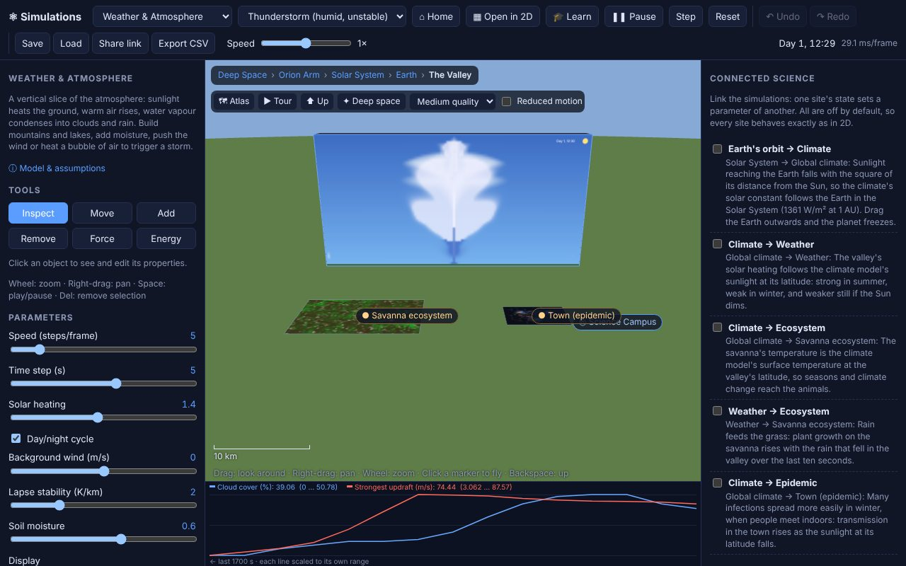

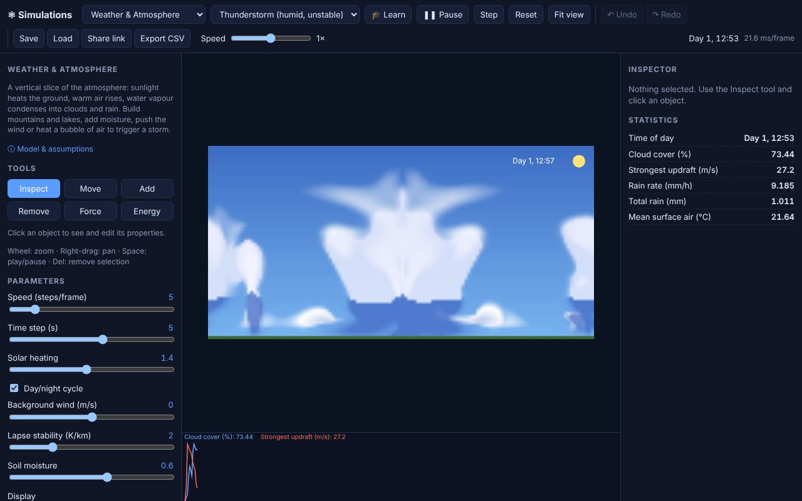

📖 **New here? Read the illustrated [User Guide](docs/USER_GUIDE.md).** Every parameter, scenario and statistic is listed in the [Simulation Reference](docs/REFERENCE.md).

```bash
npm start          # serves http://localhost:8080  (or: node server.js 3000)
npm test           # runs the physics, contract, save/load and lesson tests (Node ≥ 18)
```

## Why

Most science is taught with static diagrams and equations, but the interesting part is how
a system *responds*: what happens to the climate if CO₂ doubles, why an epidemic peaks, why
a double pendulum is chaotic, why a cell bursts in fresh water. Simulations lets you find out
by changing the system and watching what happens.

- **Learn by experimenting.** Every object and parameter can be edited while the simulation
  runs, so you can ask "what if?" and get an answer straight away.
- **One set of controls for every subject.** Gravity, chemistry, weather, biology and
  epidemiology all use the same six tools, so learning one simulation teaches you the rest.
- **Honest models.** Each simulation has a **Model & assumptions** dialog listing its
  equations, simplifications and references, so you know what it gets right and where it
  stops being realistic.
- **Nothing to install.** It is plain HTML and JavaScript: no accounts, no tracking, no build.
  It works offline once loaded (it installs as a PWA) and runs in any modern browser.

## Where to use it

| Who | How |
|---|---|
| **Teachers** (secondary school, early university) | Project a simulation in class, or send students a link to a scenario. `#weather/storm&lock=all` opens a scenario with its parameters locked so everyone starts from the same setup. |
| **Students** | Work through the guided lessons and challenges under **🎓 Learn**, or use a simulation to check homework intuition, e.g. how orbital speed depends on distance (Kepler's laws). |
| **Self-learners and the curious** | Explore anything from atoms to galaxy collisions at your own pace. Save a world to a file and come back to it later. |
| **Science communicators** | Make live demos for talks, videos or blog posts. **Share link** copies a URL with the exact scenario and parameters. |
| **Lab reports and data work** | **Export CSV** downloads the recorded statistics (temperatures, populations, energies…) to plot or analyse in a spreadsheet or notebook. |
| **Developers** | Use it as a small, dependency-free reference for numerical methods (leapfrog integration, Barnes–Hut, stable fluids, position-based dynamics, agent-based models), or add your own simulation using the [Module Guide](docs/MODULE_GUIDE.md). |

## Screenshots

| | |
|---|---|
| 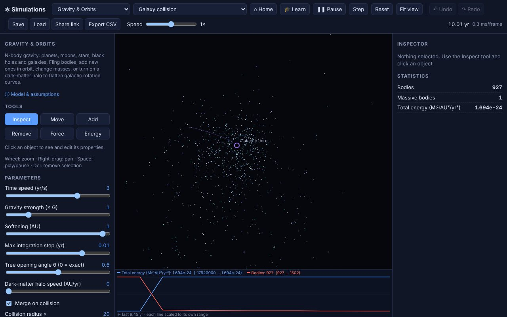 **Gravity & Orbits:** two galaxies merging | 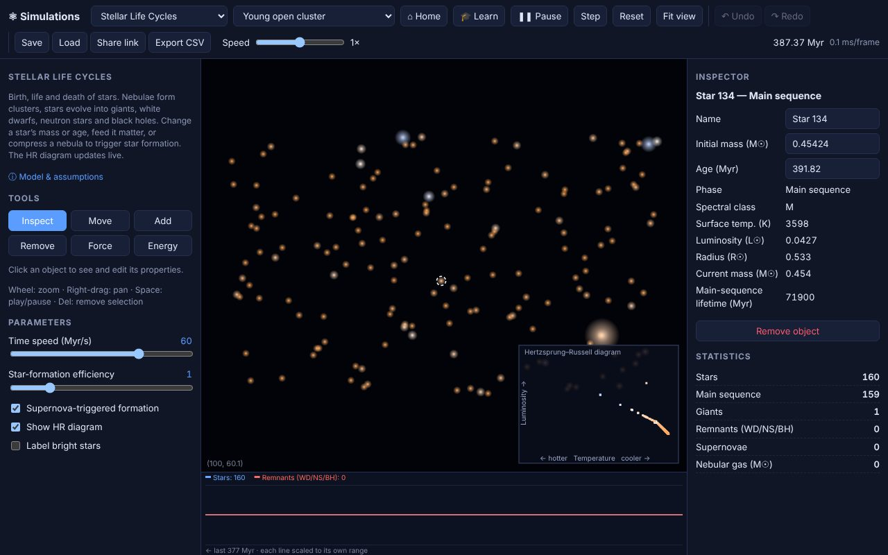 **Stellar Life Cycles:** a young cluster with a live H–R diagram |
| 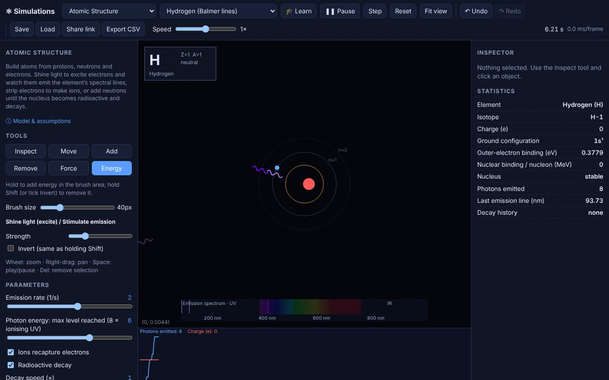 **Atomic Structure:** hydrogen and its emission spectrum | 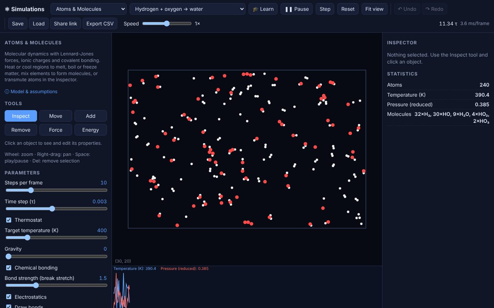 **Atoms & Molecules:** hydrogen and oxygen forming water |
| 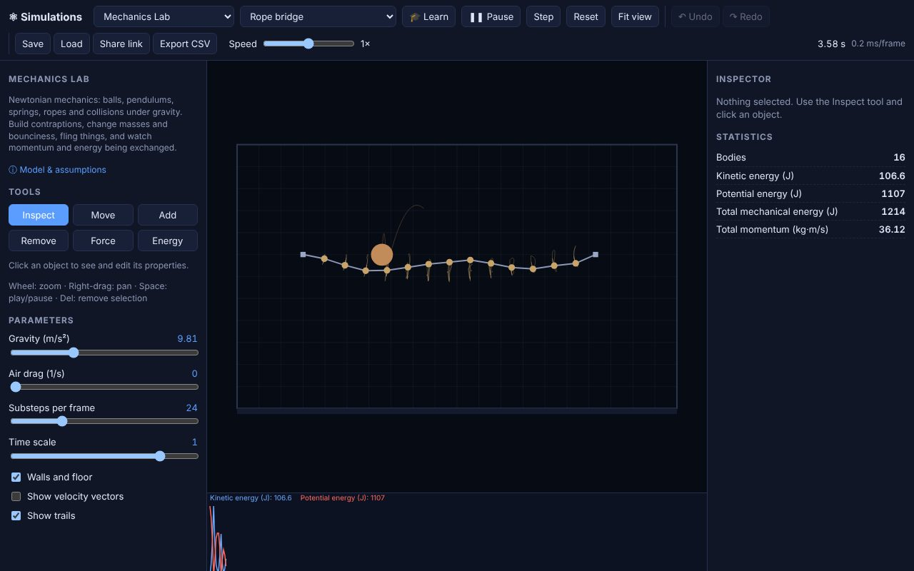 **Mechanics Lab:** a rope bridge catching a heavy ball | 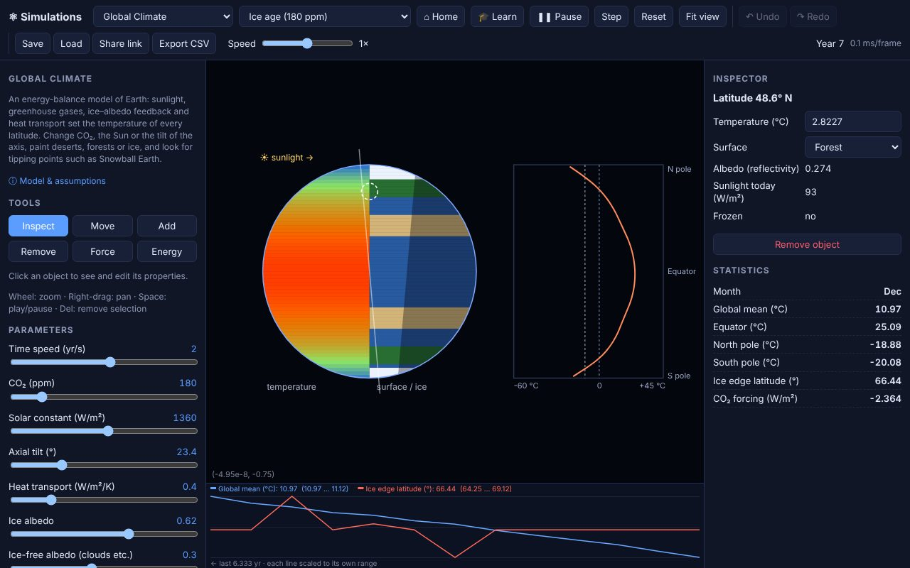 **Global Climate:** an ice-age Earth at 180 ppm CO₂ |
| 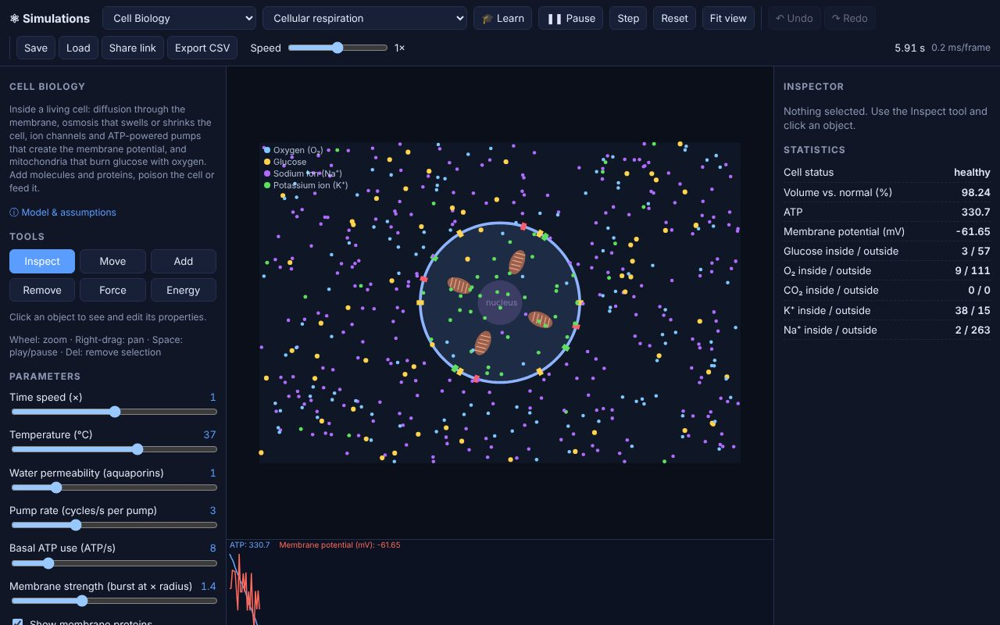 **Cell Biology:** mitochondria, pumps and the membrane potential | 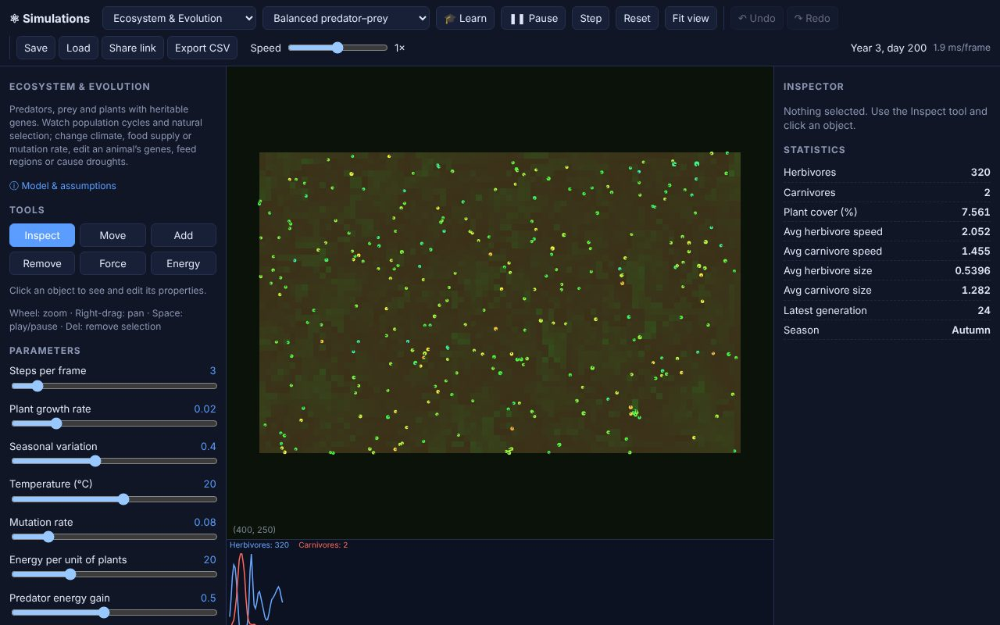 **Ecosystem & Evolution:** prey coloured by their evolving speed gene |
| 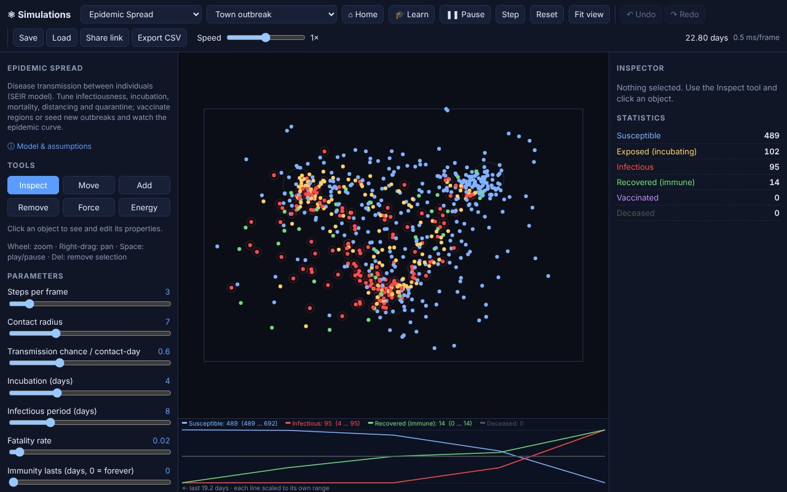 **Epidemic Spread:** an outbreak moving through a town | 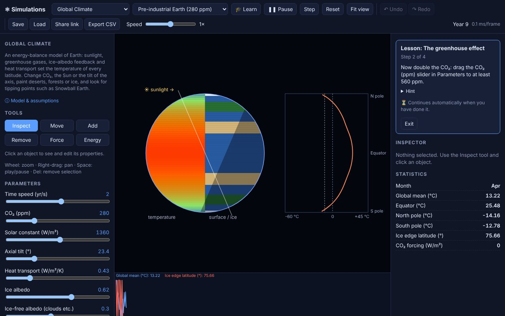 **Guided lesson:** the greenhouse effect, step by step |
| 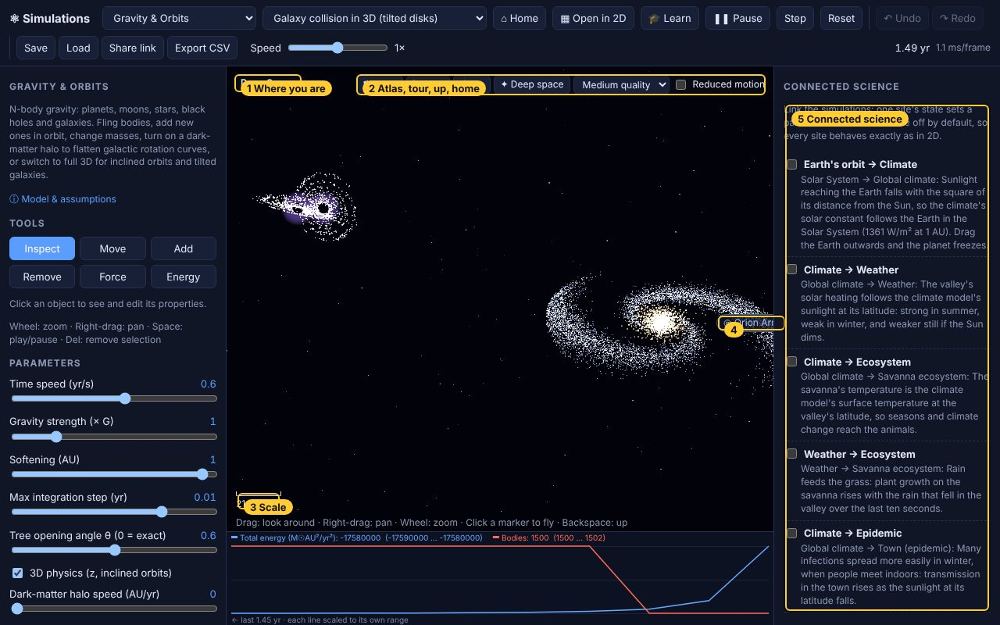 **3D world:** deep space, with the Milky Way and two galaxies colliding | 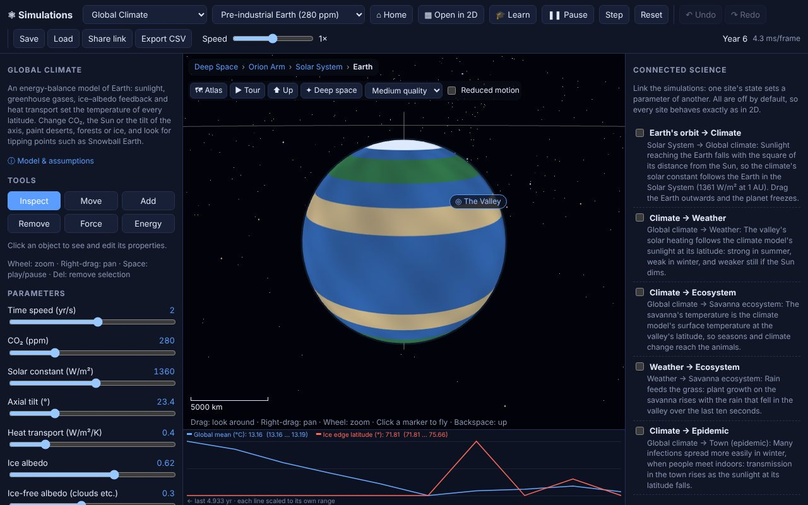 **3D world:** the climate model on a globe, with polar ice |

More screenshots, one for every tool and feature, are in the [User Guide](docs/USER_GUIDE.md).

## Simulations

| Domain | Module | What it models | Example things to try |
|---|---|---|---|
| Space | **Gravity & Orbits** (`gravity`) | N-body gravity in AU / years / solar masses with a symplectic leapfrog integrator. Collisions merge bodies; thousands of test particles for galaxies and asteroid belts. | Solar System, Earth–Moon, binary star with a circumbinary planet, figure-eight three-body orbit, spiral galaxy with a dark-matter halo, galaxy collision, a 2000-star cluster (Barnes–Hut tree), and an optional 3D mode with inclined orbits and tilted colliding galaxies (octree). Fling planets, drop in a black hole, change G. |
| Space | **Stellar Life Cycles** (`stars`) | Star formation in nebulae (Salpeter IMF), main-sequence → giant → white dwarf / neutron star / black hole, supernova shock waves that trigger new star formation, and a live Hertzsprung–Russell diagram. | Feed a star mass, change its age, compress a nebula, watch a 40 M☉ star collapse. |
| Matter | **Atomic Structure** (`atom`) | Protons, neutrons and electron shells (aufbau order), a screened hydrogen-like model for electron energies, photon absorption/emission with a live emission spectrum, ionisation and recombination, semi-empirical nuclear binding and α/β decay. | Shine light on hydrogen to see the Balmer lines, strip electrons to make ions, add neutrons to carbon until it becomes radioactive, follow the uranium-238 decay chain. |
| Matter | **Atoms & Molecules** (`atoms`) | 2D molecular dynamics: Lennard-Jones forces, Coulomb ions, covalent bonding with valence rules, thermostat, pressure. | Condense argon, melt a salt crystal, make water from H + O, transmute an atom into another element. |
| Classical | **Mechanics Lab** (`mechanics`) | Balls, anchors, rigid rods and springs under gravity with drag; position-based dynamics and momentum-conserving collisions. | Newton's cradle, chaotic double pendulum, projectiles, spring oscillators, a rope bridge, a billiards break. Change masses, bounciness and stiffness. |
| Earth | **Weather & Atmosphere** (`weather`) | 32 km × 16 km vertical slice of the atmosphere: stable-fluids dynamics, buoyancy, day/night solar heating, evaporation, condensation with latent heat, rain/snow, terrain and a tropopause. | Cumulus on a sunny day, sea breeze, orographic rain, a thunderstorm. Raise mountains, add lakes or moist air, heat a bubble, push the wind. |
| Earth | **Global Climate** (`climate`) | Latitude-resolved energy-balance model: seasonal sunlight and axial tilt, CO₂ greenhouse forcing, ice–albedo feedback and poleward heat transport (~3 K warming per CO₂ doubling). | Raise CO₂, dim the Sun into a Snowball Earth and try to escape it, remove the axial tilt, paint deserts, forests or ice sheets. |
| Life | **Cell Biology** (`cell`) | Diffusing molecules and a selectively permeable membrane: channels and transporters, osmosis (swelling, bursting, shrinking), mitochondria making ATP, Na⁺/K⁺ pumps and the membrane potential. | Put the cell in fresh water or syrup, block the glucose transporters, poison the mitochondria, drain ATP and watch the gradients run down. |
| Life | **Ecosystem & Evolution** (`ecosystem`) | Plants, herbivores and carnivores with heritable, mutating genes (speed, size, senses, fertility) and energy budgets, giving predator–prey cycles and natural selection. | Edit genes, cause droughts or fertilise land, change climate, compare fertile islands with a desert. |
| Life | **Epidemic Spread** (`epidemic`) | Agent-based SEIR disease model with mobility hubs, distancing, quarantine, vaccination, mortality and waning immunity. | Vaccinate regions, seed outbreaks, flatten the curve. |

## Lessons and challenges

Press **🎓 Learn** for guided lessons (the greenhouse effect, flattening the curve, light
from atoms, energy conservation, osmosis, predator–prey, Kepler's laws, the lives of stars,
states of matter, how clouds form) and challenges (stop an outbreak with under 30 %
vaccinated, escape Snowball Earth, transmute carbon-14, launch a planet into a circular orbit,
keep foxes and rabbits alive for three years, build a thunderstorm before sunset, assemble water,
ammonia and methane by hand). Steps advance by themselves when you do what they ask. Link to one with `#learn/<id>`, e.g. `#learn/osmosis`.

## Interaction model

Every simulation exposes the same tools, so you learn the controls once:

| Tool | Key | Effect |
|---|---|---|
| Inspect | `1` | Click an object to view **and edit** its properties (mass, velocity, element, genes, health state…) |
| Move | `2` | Drag an object somewhere else |
| Add | `3` | Add the chosen kind of object (a planet, an atom, a mountain, a predator…) |
| Remove | `4` | Click or drag to delete things |
| Force | `5` | Drag to apply an impulse to an object (or a region) |
| Energy | `6` | Hold to inject energy (heat, accretion, food, vaccine…); hold **Shift** to remove it |

Other controls: mouse wheel zooms, right-drag pans, `Space` plays/pauses, `.` steps one frame,
`f` fits the view, `Del` removes the selected object. The URL hash (`#weather/storm`) links
directly to a simulation and scenario; add `&lock=co2` (or `lock=all`) to lock parameters for a class. Each module also has global parameters (left panel),
live statistics, a time-series chart, and a **Model & assumptions** dialog listing its equations,
simplifications and references.

## Project layout

```
index.html, styles.css      app shell
server.js                   tiny static file server
src/core/                   engine pieces shared by all simulations
  simulation.js             base class and interaction contract
  random.js                 seedable RNG (reproducible scenarios)
  spatial-hash.js           neighbour queries for particle systems
  barnes-hut.js             quadtree for O(N log N) gravity
  octree.js                 its 3D counterpart (Gravity's 3D mode)
  math.js                   helpers (black-body colour, formatting…)
src/sims/                   one file per simulation module (+ index.js registry)
src/lessons/                guided lessons and challenges, and the runner that checks them
src/ui/                     camera, chart, tools and application UI
src/world/                  the 3D world: places, sites, couplings, saves and links
  engine/                   small WebGL2 engine: maths, rays, meshes, shaders, renderer, camera
  native/                   native 3D views (Gravity, the climate globe)
  ui/                       world controller, HUD, Atlas, tour, couplings panel
tests/                      node:test suites (physics, contract, world) and browser tests (tests/e2e)
docs/                       PRD, TRD, system design, module guide, test plan, roadmap, user guide, ADRs
```

## Documentation

| Document | Purpose |
|---|---|
| [Product Requirements (PRD)](docs/PRD.md) | Vision, users, goals, requirements, metrics |
| [Technical Requirements (TRD)](docs/TRD.md) | Measurable technical requirements and their status |
| [System Design](docs/SYSTEM_DESIGN.md) | Architecture, components, data flow, module internals |
| [Module Guide](docs/MODULE_GUIDE.md) | How to add a new simulation |
| [Test Plan](docs/TEST_PLAN.md) | Test strategy, inventory, release checklist |
| [Roadmap](docs/ROADMAP.md) | Milestones and future simulations |
| [3D world: plan](docs/world/PLAN.md), [PRD](docs/world/PRD.md), [TRD](docs/world/TRD.md), [design](docs/world/SYSTEM_DESIGN.md) | The single 3D world: plan and progress, requirements with status, architecture |
| [User Guide](docs/USER_GUIDE.md) | How to use the tools, experiments to try, glossary |
| [Architecture Decision Records](docs/adr/) | Key technical decisions |
| [Contributing](CONTRIBUTING.md) | Workflow and conventions |
