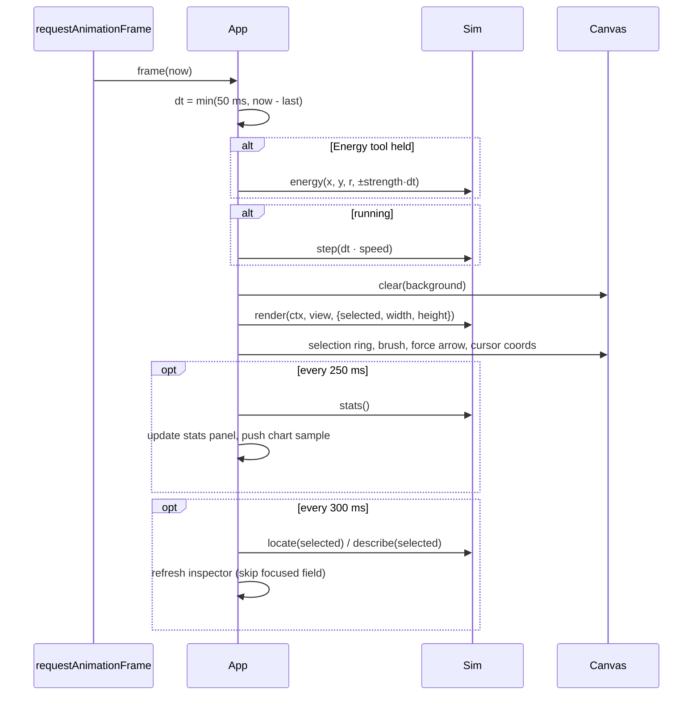

# System Design — Simulations

| | |
|---|---|
| **Status** | v1.0, describes the implemented MVP plus the planned evolution |
| **Last updated** | 2026-10-16 |
| **Related** | [PRD](PRD.md) · [TRD](TRD.md) · [Module Guide](MODULE_GUIDE.md) · [ADRs](adr/) · [Roadmap](ROADMAP.md) |

---

## 1. Overview

Simulations is a **client-only web application**. A shared shell (camera, tools,
parameter panel, inspector, statistics, chart) hosts interchangeable **simulation
modules**. Each module owns its world state and physics and exposes a uniform
**interaction contract**, so one UI can drive atoms, weather, ecosystems and
galaxies the same way.

```mermaid
flowchart LR
  User((User)) -->|pointer / keys| UI
  subgraph Browser
    UI[App shell<br/>src/ui/app.js] -->|contract calls| SIM[Active Simulation<br/>src/sims/*.js]
    UI --> VIEW[Camera<br/>view.js]
    UI --> CHART[Chart<br/>chart.js]
    SIM --> CORE[Core<br/>random · spatial-hash · math]
    SIM -->|render(ctx, view)| CANVAS[(Canvas 2D)]
    UI -->|overlays| CANVAS
  end
  REG[Registry<br/>src/sims/index.js] --> UI
  NODE[Node test runner] -->|headless| SIM
```

### Key properties
- **Zero dependencies, no build:** ES modules served as static files ([ADR-001](adr/001-zero-dependency-browser-app.md)).
- **One contract, many models:** UI and physics are fully decoupled ([ADR-002](adr/002-uniform-simulation-contract.md)).
- **Domain-appropriate numerics** per module rather than one generic engine ([ADR-003](adr/003-per-domain-numerical-methods.md)).
- **Headless-testable:** the same module code runs in Node for tests.

## 2. Context and constraints

| Constraint | Consequence |
|---|---|
| Must run instantly anywhere | Static hosting; no server-side logic; no install |
| Wide range of phenomena | Plug-in modules behind a narrow interface |
| Real-time interactivity | Fixed per-frame budget; modules sub-step internally; heavy modules expose a "steps per frame" knob |
| Learners and tinkerers | Deterministic seeds, readable code, physical units, tests |

## 3. Component design

### 3.1 Source layout

| Path | Responsibility |
|---|---|
| `index.html`, `styles.css` | Static shell: top bar, left panel (description, tools, parameters), stage (world canvas + chart), right panel (inspector, stats) |
| `src/main.js` | Bootstraps `App` with the registry |
| `src/ui/app.js` | Application controller: routing, main loop, tools, parameter UI, inspector, stats, overlays |
| `src/ui/view.js` | 2D camera: world↔screen transforms, pan, zoom-at-cursor, fit, y-up support |
| `src/ui/chart.js` | Multi-series time chart, normalised per series |
| `src/core/simulation.js` | `Simulation` base class and default contract implementations |
| `src/core/random.js` | Seedable PRNG (mulberry32) with uniform, gaussian, pick, chance |
| `src/core/spatial-hash.js` | Uniform grid for O(n) neighbour queries |
| `src/core/math.js` | clamp/lerp, black-body colour, number formatting |
| `src/sims/*.js` | Simulation modules; `index.js` is the registry |
| `server.js` | Dependency-free static dev server with path-traversal guard |
| `tests/*.test.js` | Physics tests and the cross-module contract test |

### 3.2 App shell (`App`)

**State:** active `sim`, `view`, `tool`, `selected` entity, `running`, `speed`,
pointer state, throttling timestamps.

**Main loop** (`requestAnimationFrame`):



- `dt` is clamped to 50 ms, so a background tab or a hiccup can't explode the physics.
- `step` is wrapped in try/catch; on error the app pauses (TRD FT-4).

**Routing:** `#sim/scenario` → `loadSim` / `loadScenario`. A scenario change
updates the hash with `history.replaceState`, so it does not add history entries.

**Tool dispatch** (pointer events on the world canvas):

| Tool | pointerdown | pointermove | pointerup / per frame |
|---|---|---|---|
| Inspect | `select(pick())` | pan if dragged > 4 px | — |
| Move | `dragTarget = pick()` | `move(target, x, y)` | release |
| Add | `add(kind, x, y, brush)`, select result | — | — |
| Remove | `removeAt(x, y, brush)` | repeat every 60 ms | — |
| Force | remember `{target, start}` | draw arrow | `impulse(target, x0, y0, dx, dy)` |
| Energy | — | track cursor | each frame `energy(x, y, r, ±s·dt)` |
| (any) right/middle drag | | `view.pan()` | |

### 3.3 Camera (`View`)
`screen = center + (world − c) · scale`, with y inverted when `yUp` (weather uses
altitude). `zoomAt` keeps the world point under the cursor fixed. Modules render
in screen space using `view.toScreen` and `view.scale`, which keeps line widths
and text crisp.

## 4. The simulation contract

```ts
abstract class Simulation {
  static meta: { id, title, category, description, yUp? }
  params: Record<string, number|boolean|string>; paramDefs: ParamDef[]
  scenarios: {id, label}[]; spawnKinds: {id, label}[]; chartKeys: string[]
  energyTool: {label, negLabel}; timeUnit: string; background: string; time: number

  loadScenario(id): void
  step(dtRealSeconds): void
  render(ctx, view, ui): void
  bounds(): {x, y, w, h}

  pick(x, y, r): Entity | null
  locate(e): {x, y, r? , px?} | null
  describe(e): {title, fields: Field[]} | null
  setProperty(e, key, value): void

  add(kind, x, y, r?): Entity | null
  move(e, x, y): void
  remove(e): void
  removeAt(x, y, r): Entity | null
  impulse(e | null, x, y, dx, dy): void
  energy(x, y, r, signedAmount): void

  setParam(key, value) / onParamChange(key, value)
  stats(): {key, label, value, color?}[]
  formatTime(): string
}
```

Entities are plain objects owned by the module. The UI treats them as opaque handles
and only passes them back. Entities expose `alive` so stale selections can be detected.
Full authoring guidance is in the [Module Guide](MODULE_GUIDE.md).

## 5. Module designs

### 5.1 Gravity & Orbits (`gravity.js`)
- **State:** `bodies[] {x, y, vx, vy, ax, ay, m, radius, kind, trail}`; `m = 0` marks a *test particle*.
- **Units:** AU, years, M☉, so G = 4π².
- **Integrator:** kick-drift-kick leapfrog; substeps `n = ceil(Δt / maxStep)`, capped at 500.
- **Forces:** O(M²) between massive bodies plus O(N·M) for test particles, with Plummer softening ε; optional isothermal halo `a = v₀²/r` around the heaviest body.
- **Collisions:** perfectly inelastic mergers (conserve mass and momentum); test particles absorbed.
- **Derived:** total energy, osculating orbital elements (a, e, period) for the inspector.
- **Scaling path:** Barnes–Hut quadtree, then GPU, for N massive bodies ≫ 100.

### 5.2 Stellar Life Cycles (`stars.js`, `stellar-model.js`)
- **Pure model** `evolve(M, t)`: main-sequence lifetime `t_ms = 10⁴ · M^-2.5` Myr; piecewise mass–luminosity; mass–radius; giant or supergiant expansion; remnant by mass (WD < 8 M☉ < NS < 25 M☉ < BH); Mestel-like white-dwarf cooling; `T_eff = 5778 · (L/R²)^¼`.
- **Population:** stars `{mass, age, x, y, v, state}`; nebulae `{mass, r, trigger}` spawn stars at a rate ∝ mass × (base + compression) using a Salpeter IMF.
- **Events:** a transition to NS/BH emits a supernova shell, and shells crossing a nebula raise its compression (triggered formation). WD birth emits a planetary-nebula shell.
- **Accretion tool:** changes mass and rescales age to keep the fractional lifetime.

### 5.3 Atoms & Molecules (`atoms.js`)
- **Units:** reduced LJ units (σ ≈ 3 Å, mass in amu); 1 temperature unit = 120 K.
- **Forces:** Lennard-Jones, Lorentz–Berthelot mixing, cutoff 2.5σ, via a spatial hash (cell 3); shifted Coulomb (k = 20, cutoff 6) among charged atoms; harmonic bonds (k = 300) plus soft 1–3 repulsion; per-pair force clamp for stability.
- **Chemistry:** bonds form between atoms with free valence within 1.25·r₀ and low relative speed; break beyond `bondEnergy · r₀`.
- **Integrator:** velocity Verlet, reflecting walls (pressure from wall impulse), Berendsen thermostat.
- **Census:** connected components, reported as Hill formulas.

### 5.4 Weather & Atmosphere (`weather.js`)
- **Grid:** 128 × 64 cells, Δx = 250 m (32 × 16 km); periodic in x, rigid floor and lid; terrain heights per column; land/water flags.
- **Fields:** `u, v, θ, q_v, q_c, q_r, p` (Float32Array).
- **Step (Δt = 5 s):** buoyancy (θ anomaly, vapour, condensate loading) → mean-wind nudging and lid damping → warm-rain microphysics (saturation adjustment with latent heat, autoconversion, accretion, rain evaporation) → surface heat and moisture fluxes with a diurnal cycle → semi-Lagrangian advection of u and v → pressure projection (red-black SOR, ω = 1.7, 16 sweeps) → advection of scalars (rain with 5 m/s fall speed).
- **Environment:** θ_env = 300 K + stability·z + 14 K/km above 11 km (tropopause).
- **Rendering:** fields written to an `ImageData`, scaled to the world rectangle; display modes for clouds, temperature anomaly, humidity and wind speed.

### 5.5 Ecosystem & Evolution (`ecosystem.js`)
- **World:** 800 × 500 units; grass grid 80 × 50 with fertility map and logistic regrowth (with a seed bank), modulated by season and temperature.
- **Agents:** `{species, x, y, heading, energy, age, genes{speed, size, sense, fertility}, generation}`; spatial hash for perception.
- **Behaviour:** herbivores flee predators (detected at half sense range) or seek grass; carnivores hunt when hungry, with a handling time after a kill (Holling type II).
- **Energetics:** Kleiber basal cost ∝ size^0.75 plus speed upkeep, movement and sensing costs.
- **Reproduction:** asexual, above an energy threshold; genes mutate with gaussian noise, clamped. Optional immigration rescues extinct species.

### 5.6 Epidemic Spread (`epidemic.js`)
- **Agents:** 700 people with home positions; trips to hubs; distancing and quarantine freeze movement.
- **Disease:** SEIR + V + D; transmission probability β·Δt per contact within radius; incubation and infectious periods; fatality rate; optional waning immunity.
- **Tools:** energy = vaccinate (+) / infect (−).

### 5.7 Atomic Structure (`atom.js`)
- **State:** Z, N and a list of electrons `{ n, ground, angle }`; transient photon/α/β particles for display only.
- **Electrons:** ground shells from the aufbau (Madelung) order; level energies `E = −13.6·Z_eff²/n²` eV with screening (1 per inner electron, 0.35 per same-shell electron), exact for hydrogen.
- **Light:** each absorbed photon lifts the outermost electron to a random level up to the chosen maximum (above level 7 it ionises). Excited electrons decay at a set rate to a lower level with a vacancy, emitting λ = hc/ΔE into the spectrum. Positive ions recapture electrons at the top level.
- **Nucleus:** Weizsäcker semi-empirical binding energy; decay mode from the distance to the valley of stability `Z₀ = A/(1.98 + 0.0155 A^⅔)` with a band that widens with A; α for A > 209.

### 5.8 Mechanics Lab (`mechanics.js`)
- **State:** balls `{ m, r, e, fixed }` and links (rods, springs) by reference.
- **Step:** springs as explicit forces → gravity and drag → position prediction → 4 iterations of rod projection (position-based dynamics) → velocities from positions → 3 passes of pairwise impulse collisions with restitution → walls.
- **Units:** metres, seconds, kilograms; energies and momentum in SI.

### 5.9 Global Climate (`climate.js`)
- **Grid:** 60 equal-area bands uniform in x = sin(latitude).
- **Equation:** `C ∂T/∂t = Q(x,t)(1 − α(T)) − (A − 5.35 ln(CO₂/280) + B·T) + ∂/∂x[D(1 − x²) ∂T/∂x]` with C = 12.7 W·yr/m²/K, A = 202.2 W/m², B = 2.09 W/m²/K, D = 0.43 W/m²/K.
- **Insolation:** daily-mean top-of-atmosphere formula with declination `δ = obliquity·sin(2πt)`, or the annual mean.
- **Albedo:** ice-free surface value (per painted surface) blending smoothly into ice albedo around −10 °C.
- **Integration:** explicit Euler with a diffusion-stable step (~0.01 yr). Scenarios spin up for 30 years.

### 5.10 Cell Biology (`cell.js`)
- **State:** particles `{ sp, x, y }`, membrane proteins `{ type, angle, active }`, mitochondria, ATP count, impermeant contents, radius.
- **Transport:** Brownian steps `σ = √(2·D·T/310·Δt)`. Crossing the membrane needs bilayer permeability or a matching active protein nearby; otherwise the step is rejected.
- **Osmosis:** `dA/dt ∝ Lp·(c_in − c_out)` using σ-weighted (reflection coefficient) solute concentrations; the cell lyses beyond the strength limit.
- **Metabolism:** glucose in a mitochondrion + 2 O₂ → 30 ATP + 2 CO₂ (each particle stands for many molecules), or 2 ATP + lactate without oxygen. Pumps spend 1 ATP to move 3 Na⁺ out and 2 K⁺ in.
- **Membrane potential:** Goldman–Hodgkin–Katz with P_K : P_Na = 1 : 0.04.

## 6. Data model and state

All state is in memory and owned by the active module. Switching simulations
discards the previous instance.

**Persistence.** Modules implement `saveState()` / `loadState(state)`. The base class
wraps them in `serialize()` / `deserialize()`, which produce versioned JSON:

```json
{ "format": "simulations-world", "version": 1, "sim": "weather", "scenario": "storm",
  "time": 43200, "rng": 123456789, "params": { … }, "state": { … } }
```

- Entities are saved as plain fields; object references (atom bonds) become id lists.
- Grids (weather, ecosystem) are typed arrays encoded as base64 (`src/core/serialize.js`).
- The RNG state is saved, so a restored world evolves **identically** (tested).
- `deserialize` validates the format, version and simulation id, accepts only declared
  parameters of the right type, and checks grid sizes and enum values (element, health state).

**Undo/redo** (`src/ui/history.js`) stores a snapshot from `serialize()` before every user
intervention (tool press, inspector edit, deletion), up to 40 deep.

**Share links** (`src/ui/persistence.js`) encode the simulation, the scenario and only the
parameters that differ from the scenario defaults: `#gravity/solar?gScale=2&trails=false`.
Because scenarios are seeded, this reproduces the starting world exactly. Full world state
is shared as a saved file.

**CSV export** writes the samples recorded at 4 Hz (time + every numeric statistic, up to 20 000 rows).

## 7. Performance design

| Technique | Where |
|---|---|
| Clamped frame `dt`, internal sub-stepping with caps | all |
| Spatial hashing for neighbour queries | atoms, ecosystem, epidemic |
| Test particles (no mutual forces) | gravity galaxies, asteroid belts |
| Typed arrays, precomputed solid mask, in-place red-black SOR | weather |
| Image-based field rendering (one `drawImage` per frame) | weather, ecosystem grass |
| Throttled UI work (stats 4 Hz, inspector ~3 Hz) | app |
| Bounded buffers (trails 200 points, chart 400 samples, population caps) | gravity, chart, ecosystem |

Measured step time (headless Chromium): gravity 0.1–0.6 ms, stars ~0.1 ms, atomic structure < 0.1 ms,
atoms ~3–4 ms, mechanics ~0.2 ms, climate ~0.1 ms, cell ~0.2–0.4 ms, ecosystem ~3 ms,
epidemic ~0.6 ms, weather ~20–25 ms at default settings.

**Scaling plan:** move `step()` into a Web Worker (state in transferable typed
arrays), add GPU compute (WebGPU) for grids and particles, and use Barnes–Hut for gravity.

## 8. Error handling and robustness

- Step exceptions are caught; the simulation pauses and the error is logged.
- Modules clamp user-provided values (mass ≥ 0, genes within bounds, terrain within the grid, atom positions inside the box).
- Numerical guards: softening, force clamps, CFL-respecting Δt, finite-value tests.
- The inspector ignores non-finite numeric input.

## 9. Security

Static content with no runtime network access and no user data. DOM is built with
`createElement` and `textContent` (no `innerHTML` with dynamic data). The dev server
normalises paths and refuses anything outside the root. Future world files are
untrusted input and must be schema-validated.

## 10. Testing strategy

Unit and behaviour tests run on Node's built-in runner; a contract test exercises every
registered module with every tool and scenario; a serialization test round-trips every
module; Playwright end-to-end tests (`tests/e2e/`) drive the real UI. GitHub Actions runs
both on every push and pull request. See the [Test Plan](TEST_PLAN.md).

## 11. Deployment

Any static host (GitHub Pages, Netlify, S3 + CDN). There is no build: publish
`index.html`, `styles.css`, `src/`, `manifest.webmanifest`, `sw.js` and `icon.svg`.
`.github/workflows/pages.yml` runs `npm test` and then deploys `main` to GitHub Pages
(enable *Settings → Pages → Source: GitHub Actions* once). All asset paths are relative,
so the app works under a sub-path such as `/Simulations/`.

**Offline / install (PWA).** `manifest.webmanifest` makes the app installable. `sw.js`
is a network-first service worker: online loads always get the latest deploy, and every
response is cached as a fallback for offline use. Bump `CACHE` in `sw.js` to evict old
caches.

## 12. Evolution and extension points

| Extension | Mechanism |
|---|---|
| New phenomenon | New `Simulation` subclass + registry entry ([Module Guide](MODULE_GUIDE.md)) |
| Shared physics (e.g. rigid bodies, fluids) | New helpers in `src/core/` reused by modules |
| Coupled multi-scale worlds | Future "composite" module that hosts sub-simulations and exchanges fluxes |
| Persistence and sharing | `saveState` / `loadState` on the contract (implemented) |
| Faster physics | Worker / WebGPU back-ends behind the same `step` |
| 3D | `View3D` plus an optional `render3D` on modules |
