# User Guide

A complete, illustrated guide to **Simulations**, an interactive sandbox of the natural
world: atoms, cells, ecosystems, weather, climate, planets, stars and galaxies.

> Looking for every parameter, scenario and statistic of every simulation? See the
> generated [Simulation Reference](REFERENCE.md).

## Contents

1. [Getting started](#1-getting-started)
2. [A tour of the screen](#2-a-tour-of-the-screen)
3. [Running and controlling time](#3-running-and-controlling-time)
4. [The six tools](#4-the-six-tools)
5. [Parameters, statistics and the chart](#5-parameters-statistics-and-the-chart)
6. [Undo, save, load, share and export](#6-undo-save-load-share-and-export)
7. [Lessons and challenges](#7-lessons-and-challenges)
8. [Model & assumptions](#8-model--assumptions)
9. [Teacher mode](#9-teacher-mode)
10. [Phones and tablets](#10-phones-and-tablets)
11. [The simulations, one by one](#11-the-simulations-one-by-one)
12. [Keyboard shortcuts](#12-keyboard-shortcuts)
13. [Troubleshooting](#13-troubleshooting)
14. [Glossary](#14-glossary)

---

## 1. Getting started

**Online.** When GitHub Pages is enabled for the repository (*Settings → Pages → Source:
GitHub Actions*), every push to `main` publishes the app automatically. Open the site and
it starts running immediately.

**On your computer.** You only need [Node.js](https://nodejs.org) 18 or newer; there is
nothing to install.

```bash
git clone https://github.com/faheemkhaskheli9/Simulations.git
cd Simulations
npm start              # then open http://localhost:8080
```

Use `node server.js 3000` to choose another port. Opening `index.html` directly from disk
does **not** work, because browsers block JavaScript modules on `file://` pages.

**Install it / use it offline.** The app is a Progressive Web App. In Chrome or Edge,
choose *Install* in the address bar (on phones: *Add to Home screen*). After one visit it
also works without a network connection.

**Your first minute.**

1. Pick a simulation in the first drop-down at the top (e.g. *Gravity & Orbits*).
2. Pick a scenario in the second drop-down (e.g. *Solar System*). It starts running.
3. Click something with the **Inspect** tool to see what it is, then try changing a
   number in the Inspector.
4. Press **🎓 Learn** for a guided lesson.

---

## 2. A tour of the screen

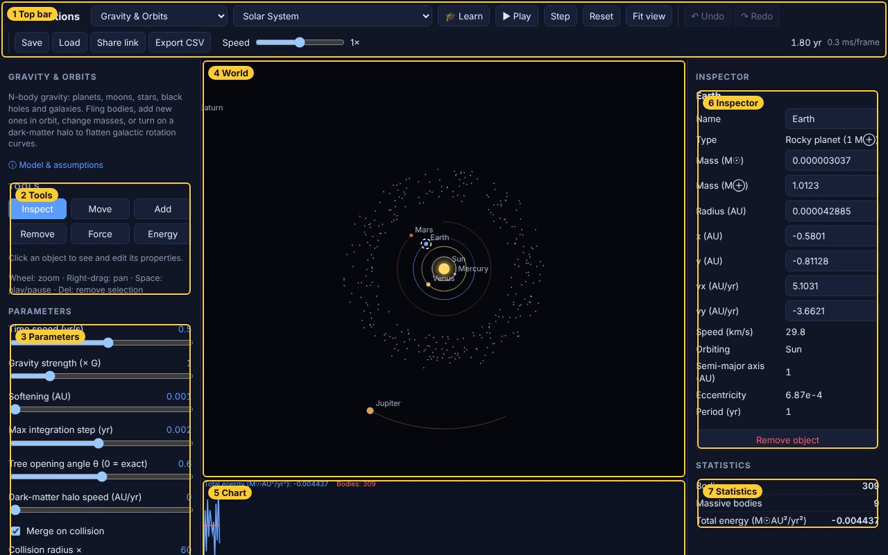

| # | Area | What it is for |
|---|---|---|
| 1 | **Top bar** | Choose the simulation and scenario, open lessons, play/pause/step/reset, undo/redo, save/load/share/export, overall speed, simulated clock and frame time |
| 2 | **Tools** | The six ways to interact with the world, plus tool options (object to add, brush size, strength) |
| 3 | **Parameters** | Global settings of the physics, changeable while it runs (gravity strength, CO₂, temperature, mutation rate…) |
| 4 | **World** | The simulation itself. Scroll to zoom, right-drag to pan |
| 5 | **Chart** | Live time series of the simulation's key numbers |
| 6 | **Inspector** | Properties of the selected object; most can be edited |
| 7 | **Statistics** | Live measurements of the whole world |

Above the tools, the left panel shows a short description of the simulation and the
**ⓘ Model & assumptions** link (see [§8](#8-model--assumptions)). When a lesson is
running, its card appears at the top of the right panel.

---

## 3. Running and controlling time


| Control | What it does |
|---|---|
| **Simulation** drop-down | Switch between the ten simulations, grouped by field (Space, Matter, Classical, Earth, Life) |
| **Scenario** drop-down | Load a ready-made setup, such as *Solar System* or *Thunderstorm* |
| **▶ Play / ❚❚ Pause** | Start or stop time (`Space`) |
| **Step** | Advance a single frame while paused (`.`) |
| **Reset** | Reload the current scenario from scratch |
| **Fit view** | Zoom and centre so the whole world is visible (`f`) |
| **Speed** | Overall time multiplier from ⅛× to 8×, applied on top of each simulation's own speed parameter |
| Clock (right) | Simulated time in the simulation's own unit: years, million years, seconds, days, or the time of day |
| ms/frame | How long the physics takes per frame (lower is faster) |

Every simulation also has its own speed parameter (e.g. *Time speed (yr/s)* or *Steps per
frame*) in the Parameters panel. Use it for big changes, and the top-bar multiplier for
quick ones. You can use every tool while paused.

---

## 4. The six tools

The same six tools work in every simulation. What exactly "add" or "energy" means depends
on the world you are in; the [Reference](REFERENCE.md) lists it for each one.

| Tool | Key | In one line |
|---|---|---|
| Inspect | `1` | Select an object, read and edit its properties |
| Move | `2` | Drag an object somewhere else |
| Add | `3` | Put new objects into the world |
| Remove | `4` | Delete objects (click or drag) |
| Force | `5` | Push an object or region by dragging an arrow |
| Energy | `6` | Pump energy into (or out of) a region |

### Inspect

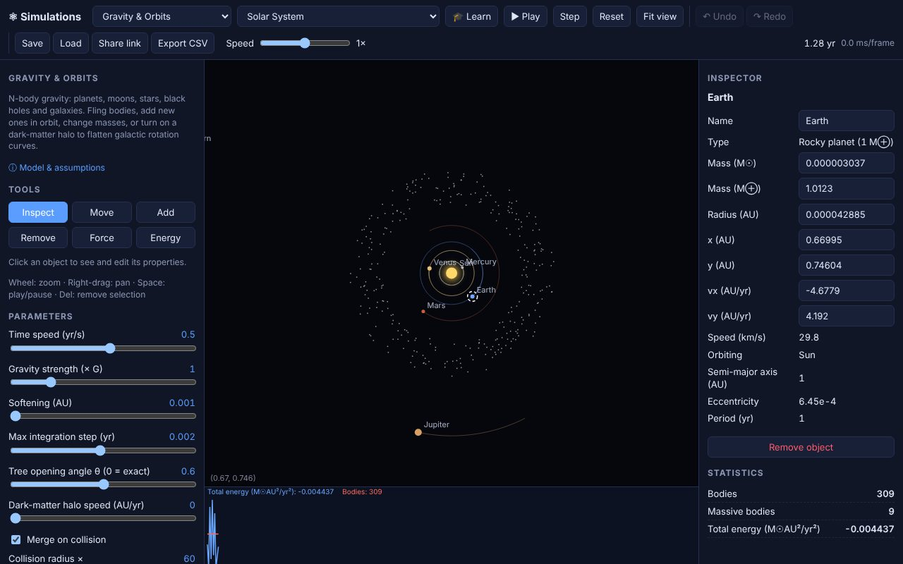

Click any object. A dashed ring marks the selection, and the **Inspector** shows its
properties. White boxes are editable: type a value and press `Enter` (or click away).
Grey values are read-only measurements, such as Earth's orbital *period* and
*eccentricity* above. Buttons in the inspector run actions, such as *Break all bonds*,
*Clone this animal* or *Force a decay now*. **Remove object** (or `Del`) deletes the
selection, and `Esc` clears it.

With Inspect active, dragging on empty space pans the view.

### Move

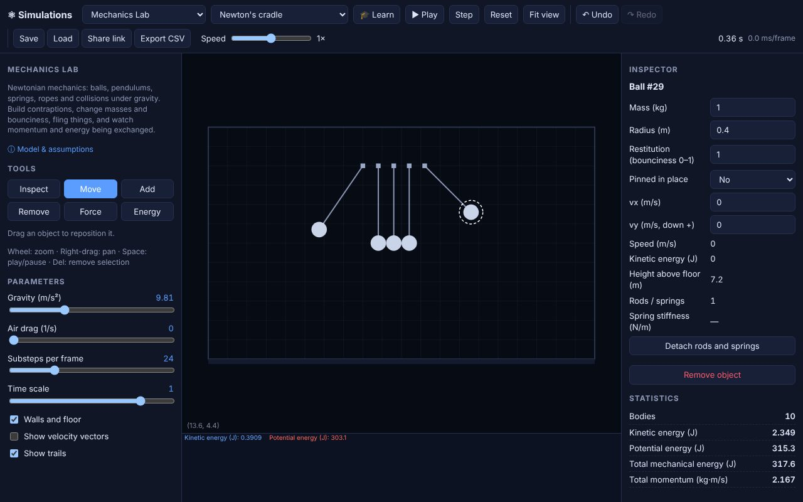

Press on an object and drag it. Rods and springs attached to it follow; in the cradle
above, the rod stretches to the new position. Moved objects keep their other properties.

### Add

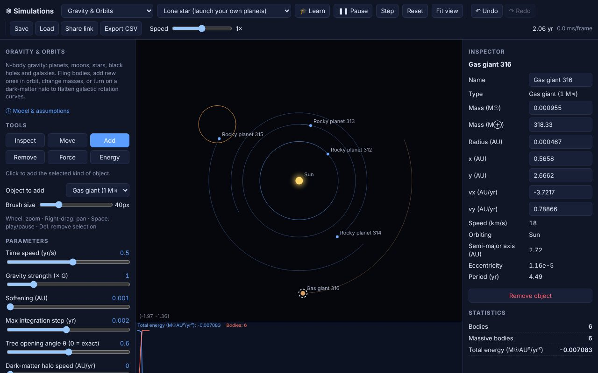

Choose what to create in **Object to add**, then click in the world. Some kinds add a
group or use the **Brush size**: a dust cloud, a herd of animals, a crowd of people, ten
molecules, a patch of plants. In *Gravity & Orbits*, new bodies start on a circular
orbit around the nearest strong attractor, so the planets above were launched simply by
clicking at different distances from the star.

### Remove

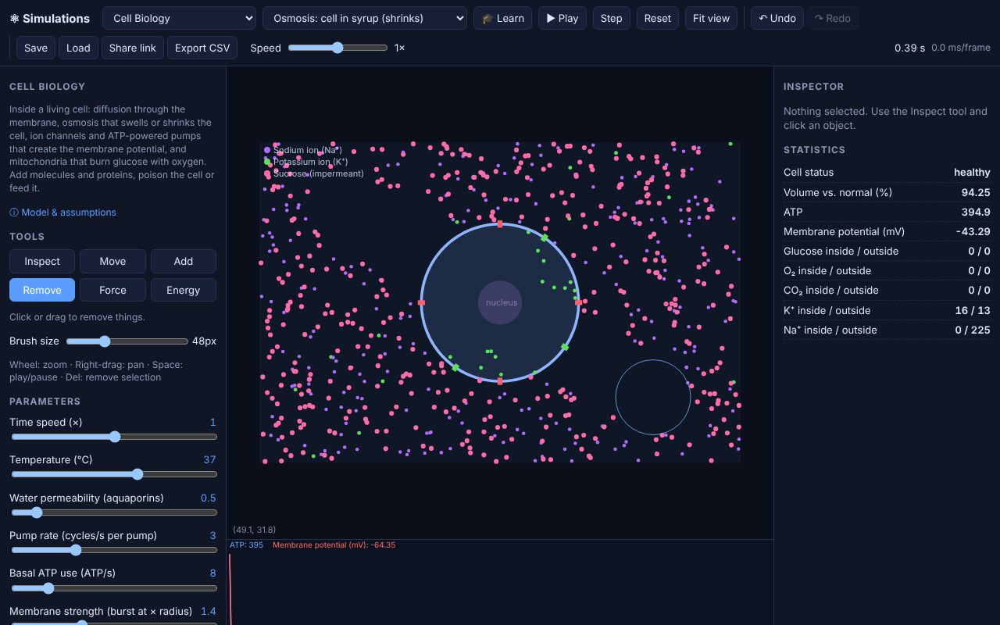

Click to delete the object under the cursor, or drag to delete everything along the
path. The circle shows the brush. In the screenshot, a diagonal stripe of molecules has
been cleared outside a cell. Some worlds remove something else where there is nothing to
delete: in *Weather*, clicking near the ground erodes terrain and higher up dries the air;
in *Ecosystem*, empty ground loses its plants; in *Climate*, painted surfaces revert to
ocean.

### Force

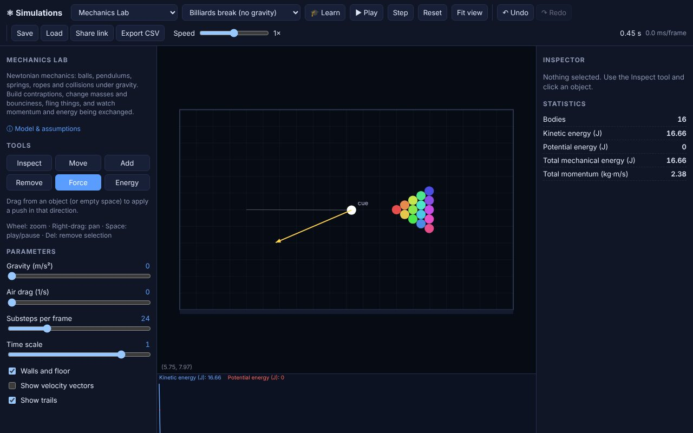

Press on an object, drag in the direction you want to push, and release. The yellow arrow
previews the push, and longer arrows push harder. Starting on empty space pushes
everything nearby (a gust of wind in *Weather*, a current of molecules in *Cell*, a crowd
in *Epidemic*).

### Energy

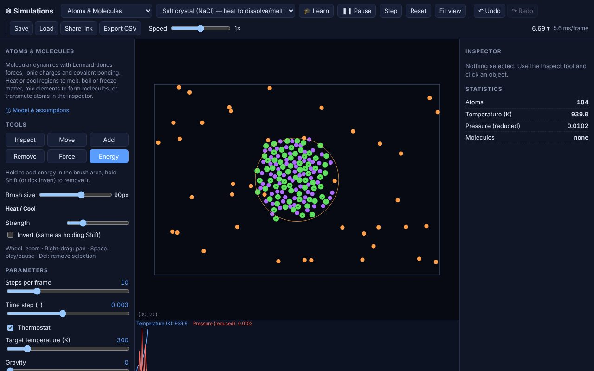

Hold the mouse button: energy flows into everything inside the brush circle for as long
as you hold. Hold **Shift**, or tick **Invert**, to take energy out instead. **Strength**
sets the rate. Its meaning depends on the world, and the label under the tool says which:

| Simulation | Energy adds… | Shift / Invert… |
|---|---|---|
| Gravity & Orbits | speed (heat) | slows bodies |
| Stellar Life Cycles | matter (accretion) / compresses gas | strips mass |
| Atomic Structure | light (excites electrons) | stimulated emission |
| Atoms & Molecules | heat | cools |
| Mechanics Lab | shaking | braking |
| Weather & Atmosphere | heat to the air | cools the air |
| Global Climate | heat to latitudes | cools them |
| Cell Biology | ATP | poison (drains ATP) |
| Ecosystem & Evolution | food / fertiliser | drought / starvation |
| Epidemic Spread | vaccination | infection |

In the screenshot, the salt crystal (sodium and chloride ions) is held inside the brush
and heated to about 940 K, and the lattice starts to break up.

---

## 5. Parameters, statistics and the chart

**Parameters** (left panel) change the rules of the world while it runs: drag a slider,
tick a box or pick from a list. The value is shown on the right of each slider. Sliders
marked *log scale* in the Reference cover several orders of magnitude, so small movements
at the left end make fine changes. Loading a scenario resets the parameters to that
scenario's values.

**Statistics** (right panel) are live measurements of the whole world, updated four times
a second: total energy, temperature, populations, cloud cover, membrane voltage, the
element and isotope, and so on.

**The chart** under the world plots two to four key statistics over time. Each line is
scaled to its own range so that different units fit together, so read exact values from
the legend above it. The chart shows the last 100 seconds of running time (it pauses with the simulation).
Use **Export CSV** to keep the full history.

---

## 6. Undo, save, load, share and export


| Button | Shortcut | What it does |
|---|---|---|
| ↶ **Undo** / ↷ **Redo** | `Ctrl+Z` / `Ctrl+Shift+Z` (or `Ctrl+Y`) | Step back or forward through your last 40 interventions: tool uses, inspector edits, deletions |
| **Save** | `Ctrl+S` | Download the whole world (every object, every parameter, the clock and the random-number state) as a `.json` file |
| **Load** | | Open a saved file. It switches to the right simulation automatically and continues exactly where it was saved |
| **Share link** | | Copy a link to the current simulation, scenario and any parameters you changed |
| **Export CSV** | | Download every statistic recorded while the simulation ran, one row per quarter second, for a spreadsheet or analysis |

**Links** look like `#weather/sunny?sun=1.6&wind=6` and you can edit them by hand. The
part after `#` is the simulation and scenario; after `?` come parameters, using the *link
keys* listed in the [Reference](REFERENCE.md). Scenarios are reproducible, so a link
recreates the same starting world. A **saved file** captures everything, including what
you added or changed by hand.

---

## 7. Lessons and challenges

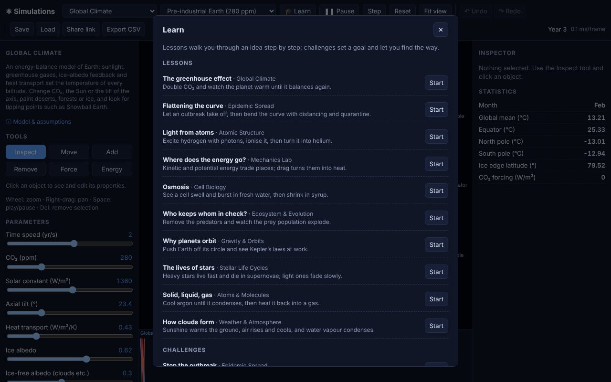

Press **🎓 Learn** in the top bar. **Lessons** walk you through one idea in a few steps;
**challenges** set a goal and a rule and leave the method to you.


The lesson card sits at the top of the right panel. It shows the current step, an
optional **Hint**, and moves on by itself as soon as you have done what it asks (steps
that only explain something wait for **Next**). In a challenge, breaking the rule ends
the attempt and offers **Try again**. Switching to another simulation, or pressing
**Exit**, ends the lesson. Completed lessons get a ✓ in the catalogue (remembered in
this browser only).

| Lessons | Challenges |
|---|---|
| The greenhouse effect (Climate) | Stop the outbreak (Epidemic) |
| Flattening the curve (Epidemic) | Escape Snowball Earth (Climate) |
| Light from atoms (Atomic Structure) | Transmute carbon (Atomic Structure) |
| Where does the energy go? (Mechanics) | Launch a planet (Gravity) |
| Osmosis (Cell Biology) | Balance an ecosystem (Ecosystem) |
| Who keeps whom in check? (Ecosystem) | Make a thunderstorm (Weather) |
| Why planets orbit (Gravity) | Build molecules (Atoms & Molecules) |
| The lives of stars (Stellar Life Cycles) | |
| Solid, liquid, gas (Atoms & Molecules) | |
| How clouds form (Weather) | |

Link straight to any lesson with `#learn/<id>`, e.g. `#learn/greenhouse`; the
[Reference](REFERENCE.md#lessons-and-challenges) lists every id.

---

## 8. Model & assumptions

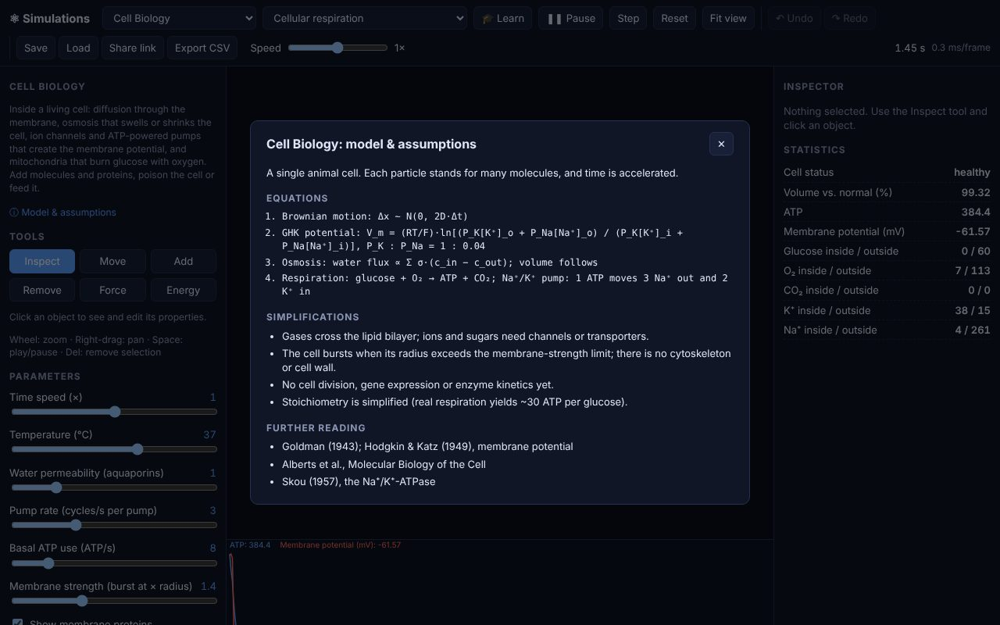

Every simulation is a simplified model of reality. **ⓘ Model & assumptions** (under the
description in the left panel) explains the model: a summary, the **equations** it
solves, what it **simplifies or leaves out**, and **further reading**. Read it before
drawing conclusions from a simulation. The same notes appear in the
[Reference](REFERENCE.md).

---

## 9. Teacher mode

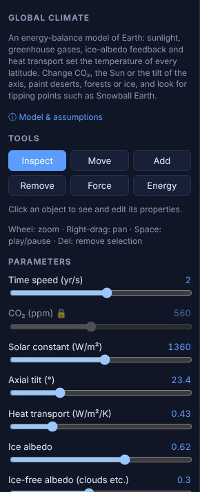

Add `lock=` to a link to freeze parameters for learners:

- `#climate/preindustrial?co2=560&lock=co2` locks CO₂ at 560 ppm.
- `lock=co2,solar` locks several parameters; `lock=all` locks every parameter.

Locked sliders are greyed out with a 🔒 and keep the link's value even when the scenario
changes. Tools, the inspector and the other parameters still work, so students can
experiment within the setup you chose.

---

## 10. Phones and tablets

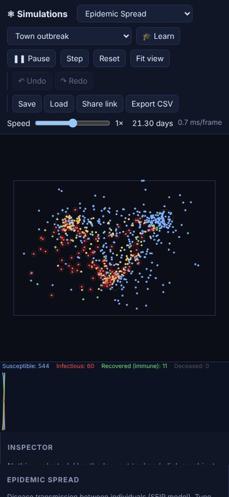

On narrow screens the layout stacks: top bar, then the world, then the inspector and
statistics, then the tools and parameters (scroll down).

- Tap to use the current tool; drag with one finger for Move, Remove, Force and Energy.
- **Pinch** with two fingers to zoom and drag with two fingers to pan.
- There is no Shift key on touch screens, so tick **Invert** to remove energy.

<br clear="right" />

---

## 11. The simulations, one by one

Each section shows the simulation, what its scenarios demonstrate, and experiments to
try. Every parameter, addable object and statistic is listed in the
[Reference](REFERENCE.md).

### Gravity & Orbits · Space


Newtonian gravity for planets, moons, stars, black holes and galaxies, in astronomical
units (AU, years, solar masses). Massive bodies attract each other and merge when they
collide; galaxy and asteroid "stars" are light test particles. Large systems use a
Barnes–Hut tree.

**Scenarios:** Solar System, Earth & Moon, binary star with a circumbinary planet,
three-body figure-eight, spiral galaxy, galaxy collision, star cluster, lone star, empty
space.

**Try this**
- In the *Solar System*, inspect Earth: its period is 1 year. Multiply Jupiter's mass by
  100 and watch the asteroid belt scatter.
- *Lone star*: use Add to launch planets at different distances. Inner planets orbit
  faster (Kepler's third law).
- *Figure-eight*: nudge one star with Force. The dance falls apart (chaos).
- *Spiral galaxy*: set *Dark-matter halo speed* to 0 and the outer stars drift away, which
  is why astronomers proposed dark matter.
- *Galaxy collision*: the cores merge and the stars are flung into tidal tails.

### Stellar Life Cycles · Space


Stars are born from nebulae, burn on the main sequence, swell into giants and end as
white dwarfs, neutron stars or black holes, depending on their mass. Supernova shock waves
can trigger new star formation. The **HR diagram** (bottom right) plots every star's
luminosity against its temperature, with the selected star shown in white.

**Scenarios:** stellar nursery, young open cluster, mass sequence (0.5 → 40 M☉), old
globular cluster, empty region.

**Try this**
- *Mass sequence*: speed time up. The heaviest stars die first, in supernovae.
- Inspect a star and change its **Initial mass** or **Age** to jump through its life.
- Hold Energy on a nebula to compress it and set off a burst of star formation.

### Atomic Structure · Matter


Build atoms from protons, neutrons and electrons. Light excites electrons; as they fall
back they emit photons at the element's characteristic wavelengths, which fill the
**emission spectrum** strip. Unstable nuclei decay by alpha or beta emission.

**Scenarios:** hydrogen, helium, carbon-12, carbon-14, neon, iron-56, uranium-238.

**Try this**
- *Hydrogen*: hold the Energy tool on the atom. Ultraviolet Lyman lines and visible Balmer
  lines (656 nm red, 486 nm blue-green…) appear in the spectrum.
- Set *Photon energy* to its maximum (ionising UV) to knock electrons off; the ion then
  recaptures electrons and glows.
- Add **protons** to change the element and **neutrons** to make isotopes. Carbon-14 is
  radioactive and decays to nitrogen-14.
- *Uranium-238*: follow the alpha-decay chain in the *Decay history* statistic.
- Inspect the nucleus: iron-56 has the highest binding energy per nucleon.

### Atoms & Molecules · Matter


Molecular dynamics: atoms attract and repel (Lennard-Jones forces), ions feel electric
forces, and atoms with free bonds join into molecules. Temperature, pressure and the
molecules present are measured live.

**Scenarios:** argon gas, argon condensing, salt crystal, hydrogen + oxygen → water,
carbon + hydrogen soup, noble-gas mixture with gravity, molecule kit.

**Try this**
- *Argon condensing*: droplets form at 60 K. Raise *Target temperature* to boil them.
- *Salt crystal*: heat it with the Energy tool to melt the lattice.
- *Hydrogen + oxygen*: watch the *Molecules* statistic fill with H₂ and H₂O.
- *Molecule kit*: drag hydrogens next to C, N and O with Move to build CH₄, NH₃ and H₂O.
- Inspect an atom and change its **Element** to transmute it.
- Turn on *Gravity* to see a gas settle into an atmosphere, densest at the bottom.

### Mechanics Lab · Classical


Balls, anchors, rigid rods and springs under gravity, in metres, seconds and kilograms.
Collisions conserve momentum; the statistics track kinetic, potential and total energy.

**Scenarios:** Newton's cradle, double pendulum, projectiles, mass–spring oscillators,
rope bridge, billiards break, empty lab.

**Try this**
- *Newton's cradle*: momentum passes through the row. Halve one ball's mass in the
  Inspector and see what changes.
- *Double pendulum*: give it a tiny nudge with Force; small differences grow fast (chaos).
- Set a ball's **Restitution** to 0 (clay) or 1 (a perfect bounce) and watch total energy.
- Add *Ball on a spring to nearest* or a *Rope* and build your own contraption.

### Weather & Atmosphere · Earth


A slice of sky 32 km wide and 16 km tall. Sunlight warms the ground, warm air rises and
cools, water vapour condenses into clouds (releasing heat) and falls as rain or snow.
Mountains, lakes and the day–night cycle shape the weather.

**Scenarios:** sunny day over land, coastline sea breeze, orographic rain over a mountain,
thunderstorm, clear night.

**Try this**
- *Sunny day*: cumulus clouds pop up around midday.
- *Sea breeze*: the land heats faster than the sea, so the wind blows inland.
- *Mountain*: moist wind forced up the slope rains on the windward side.
- *Thunderstorm*: the cloud rises until the tropopause stops it and spreads into an anvil.
- Add moist air or lakes, raise mountains, or heat a bubble of air near the ground.
- Switch *Display* to temperature anomaly, humidity or wind speed.

### Global Climate · Earth


An energy-balance model of the whole planet, by latitude: sunlight with seasons and axial
tilt, CO₂ greenhouse forcing, ice that reflects sunlight, and heat carried toward the
poles. The globe shows temperature on its left half and the surface (ocean, land, ice) on
its right; the graph shows temperature from pole to pole. About 3 °C of warming per
doubling of CO₂.

**Scenarios:** pre-industrial, today, doubled CO₂, ice age, Snowball Earth, hothouse, no
axial tilt.

**Try this**
- Raise **CO₂** from 280 to 560 ppm and wait for the new equilibrium (about 3 °C warmer).
- *Snowball Earth*: set the Sun back to 1361 W/m² and the planet *stays* frozen, because
  the ice reflects the sunlight (hysteresis). How much CO₂ does it take to thaw?
- Set the **axial tilt** to 0° or 90° and see the seasons change.
- Use Add to paint ice sheets, deserts or forests on latitude bands.

### Cell Biology · Life


Inside a living cell: molecules diffuse; gases cross the membrane freely, while ions and
sugar need channels and transporters (the coloured blocks on the membrane). Mitochondria
burn glucose with oxygen to make ATP, which powers the Na⁺/K⁺ pumps that create the
membrane voltage. Water follows dissolved particles (osmosis).

**Scenarios:** cellular respiration, diffusion, resting membrane potential, cell in fresh
water, cell in syrup.

**Try this**
- *Fresh water*: water rushes in until the cell bursts. *Syrup*: it shrinks and wrinkles.
- *Resting potential*: about −65 mV. Poison the cell (Shift + Energy) and watch the
  voltage run down as the pumps stop.
- Inspect a membrane protein and set *Working* to *No* to block it.
- Remove the glucose transporters and see glucose stay outside.

### Ecosystem & Evolution · Life


Plants, herbivores and carnivores, each animal with heritable genes (speed, size, senses,
fertility) that mutate in its offspring. Populations rise and crash in cycles, and
natural selection changes the average genes over generations (see the statistics).

**Scenarios:** balanced predator–prey, prey only, fertile islands, fast predator invasion.

**Try this**
- Watch the chart for predator–prey cycles: prey boom, predators follow, prey crash.
- Set *Colour animals by* to **Speed gene** (as above): under predation, prey evolve to
  be faster and smaller.
- Inspect an animal and edit its genes, or press *Clone this animal* to spread a mutant.
- Raise the temperature to 40 °C, or cause a drought, and see who survives.
- Turn off *Immigration* and see whether both species can survive on their own.

### Epidemic Spread · Life


People move between homes and busy hubs, catching and passing on a disease: susceptible
(blue) → exposed (yellow) → infectious (red) → recovered (green), or deceased. Distancing,
quarantine, vaccination and waning immunity can all be tested.

**Scenarios:** town outbreak, with social distancing, 60 % vaccinated, waning immunity
(endemic).

**Try this**
- Compare the chart for *Town outbreak*, *Social distancing* and *60 % vaccinated*.
- Turn on *Quarantine symptomatic*, or vaccinate a ring around the outbreak with the brush.
- *Waning immunity*: the disease never quite goes away.

---

## 12. Keyboard shortcuts

| Key | Action |
|---|---|
| `Space` | Play / pause |
| `.` | Step one frame |
| `f` | Fit view |
| `1` – `6` | Inspect, Move, Add, Remove, Force, Energy |
| `Shift` (hold) | Energy tool removes energy |
| `Esc` | Clear the selection |
| `Delete` | Remove the selected object |
| `Ctrl+Z` | Undo |
| `Ctrl+Shift+Z` / `Ctrl+Y` | Redo |
| `Ctrl+S` | Save the world to a file |
| Mouse wheel | Zoom at the cursor |
| Right-drag | Pan |

On a Mac, use `⌘` instead of `Ctrl`.

---

## 13. Troubleshooting

| Problem | Fix |
|---|---|
| Blank page when opening `index.html` directly | Browsers block JavaScript modules on `file://`. Run `npm start` and open http://localhost:8080 |
| The simulation runs slowly | Lower the simulation's *Steps per frame* / *Speed* parameter or the top-bar speed. *Weather* is the heaviest simulation |
| Things flew off the screen | Press `f` (Fit view), or **Reset** |
| Everything died out or exploded | That can be real science, or a too-large time step. Press **Reset**, or **Undo** your last change |
| A slider won't move | It is locked by a teacher-mode link (🔒). Open the simulation without `lock=` in the link |
| "Could not load …" | The file is not a Simulations save, or was edited. Saves from newer versions of the app can't be opened in older ones |
| The site shows an old version | The offline cache refreshes on the next load: reload the page once |

---

## 14. Glossary

| Term | Meaning |
|---|---|
| Albedo | Fraction of sunlight a surface reflects (ice ≈ 0.6, ocean ≈ 0.06) |
| Alpha / beta decay | A nucleus emitting a helium nucleus (α), or turning a neutron into a proton (β⁻) or vice versa (β⁺) |
| ATP | The cell's energy currency |
| AU | Astronomical unit, the Earth–Sun distance (≈ 150 million km) |
| Climate sensitivity | Long-term warming for a doubling of CO₂ |
| Emission spectrum | The wavelengths an element emits when its electrons fall to lower energy levels |
| HR diagram | Hertzsprung–Russell diagram: star luminosity against surface temperature |
| IMF | Initial mass function, the distribution of masses of newborn stars |
| Isotope | Atoms of the same element with different numbers of neutrons |
| Lennard-Jones | A model of attraction and repulsion between neutral atoms |
| M☉, L☉, R☉ | Mass, luminosity and radius of the Sun |
| Membrane potential | Voltage across a cell membrane, set by ion gradients |
| Mutation | Random change in an offspring's genes |
| Osmosis | Water moving across a membrane toward the side with more dissolved particles |
| Potential temperature (θ) | Temperature air would have if brought to sea-level pressure; equal θ means neutral buoyancy |
| Relative humidity | Water vapour as a percentage of what the air can hold |
| Restitution | How bouncy a collision is: 0 = sticks, 1 = no energy lost |
| SEIR | Susceptible → Exposed → Infectious → Recovered disease model |
| Softening | A small distance added to avoid infinite forces at close range |
| Test particle | A body that feels gravity but has no gravity of its own |
| Thermostat | An algorithm that holds a simulated system near a target temperature |
| Tropopause | Boundary (~11 km) above which the stable stratosphere stops storms rising |
| Valence | The number of covalent bonds an atom can form |

---

*The screenshots in this guide are produced by `npm run docs:screenshots`
(`scripts/screenshots.mjs`), which drives the real app in Chromium, so they can be
regenerated whenever the interface changes.*
