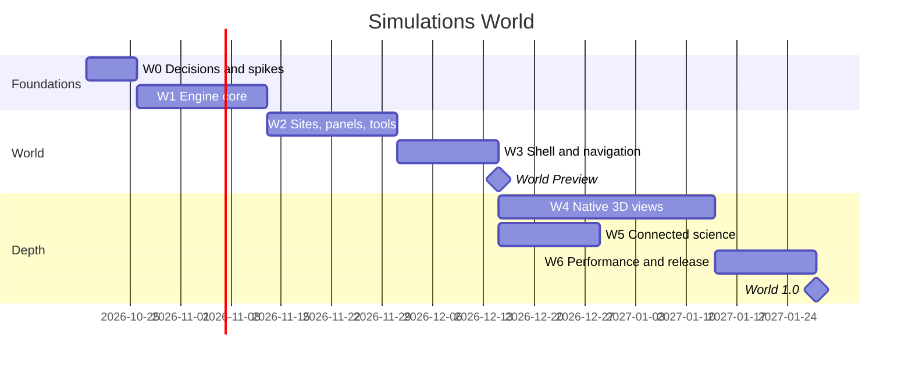

# Plan — Simulations World (3D)

| | |
|---|---|
| **Status** | In progress: World Preview shipped (W0–W3, W5), W4 and W6 partly done |
| **Last updated** | 2026-10-19 |
| **Related** | [PRD](PRD.md) · [TRD](TRD.md) · [System Design](SYSTEM_DESIGN.md) · [Roadmap](../ROADMAP.md) (M4 3D view, M6 multi-scale worlds) |

## Goal

Build **one 3D world that contains every simulation**: a nested ladder of places from a
galaxy to an atom, each existing module placed in it as a site, with the same tools,
panels, lessons, saving and sharing as the 2D app, and later with couplings between
sites. The 2D app stays as the reference and fallback.

## Approach in one paragraph

Wrap, don't rewrite. Every module first enters the world unchanged, drawn into a texture
on a surface in 3D (the surface adapter), so the whole catalogue is in the world early.
Native 3D views then replace surfaces one module at a time, where 3D adds understanding.
Couplings come last, once every site is stable. A small in-house WebGL2 engine keeps the
project dependency-free; nested places with their own units keep it precise at every
scale.

## Progress (2026-10-19)

The first implementation covers W0–W3, the two P0 native views, the couplings, the tour and
the tests, as the [design review](REVIEW.md) (R15) proposed. GitHub issue #2 tracks the rest.

| Phase | Status | What is done | What is left |
|---|---|---|---|
| W0 Decisions and spikes | ✅ Done | ADR-006/007/008 accepted; the spikes became the real engine; WebGL2 confirmed in CI (Chromium + SwiftShader) | Upload cost on the reference laptop (only software-GPU numbers so far) |
| W1 Engine core | ✅ Done | `math3d`, `ray`, `gl`, `meshes`, `materials`, `renderer`, `camera3d`, `places`, with Node tests | Wide lines (WebGL2 draws 1 px lines) |
| W2 Sites, panels, tools | ✅ Done | `App.bindSim` instead of a separate `SitePanels` (R1); surface, gravity and globe sites; all six tools through the shared `ToolSession`; scheduler; lazy sites; contract, parity and layout tests | — |
| W3 Shell and navigation | ✅ Done (**World Preview**) | `#world/…` routes, *Enter the 3D world*, breadcrumb, scale bar, markers, Atlas, tour, backdrops, world save/load, touched-site tracking, per-site undo, *Open in 2D*, WebGL2 fallback, slow-device offer, offline cache, 25 browser tests | — |
| W4 Native 3D views | ◐ Partial | Climate globe; Gravity drawn natively in 3D (galaxies, Solar System, Earth & Moon); Gravity 3D physics mode (`z`, `vz`, octree Barnes–Hut, *Inclined orbits* and *Galaxy collision in 3D* scenarios, the latter in deep space) | Orbit ellipses, Ecosystem terrain, Weather volume, Atoms 3D mode, Cell and Atom spheres (all run as surfaces today) |
| W5 Connected science | ✅ Done | Five couplings: Earth's orbit → Climate, Climate → Weather, Climate → Ecosystem, Weather → Ecosystem, Climate → Epidemic; loop check, smoothing, clamping, panel, read-only driven parameters | Stars → Climate (needs a "Sun" star in Stars); a "Dim the Sun" lesson |
| W6 Performance and release | ◐ Partial | Guided tour, lessons fly to their site, soak test with all couplings, User Guide chapter and screenshots, keyboard Atlas, live-region breadcrumb, reduced motion | Performance budgets on the reference laptop (W-PR-1…8), 30-minute memory run |

### Measured so far

Headless Chromium with **SwiftShader (a software GPU)** at 1400 × 850, so these numbers are
a floor for CI, not the reference-laptop targets of W-PR-1…8:

| Active site | World CPU time per frame | Draw calls |
|---|---|---|
| Colliding galaxies (deep space) | 0.9 ms | 4 |
| Solar System | 2.9 ms | 19 |
| Global climate (globe) | 5.4 ms | 18 |
| Weather (valley) | 32 ms (the Weather module's own step dominates) | 13 |
| Mechanics, Cell, Atoms, Atom | 5–9 ms | 2–5 |

First world frame: under 0.3 s after page load on a local server. World code: 134 KB
(budget 250 KB, W-TC-6), checked by a test.

## Phases

Estimates assume one developer working part time-equivalent to ~20 h/week; adjust
linearly. Each phase ends with a demo, green CI and updated docs.

### W0 — Decisions and spikes (1 week)
| Task | Output |
|---|---|
| Accept ADR-006 (WebGL2 in-house), ADR-007 (nested places), ADR-008 (sites wrap modules) | ADRs marked Accepted |
| Spike: WebGL2 context, instanced spheres, a textured quad from a module's `render()` | Throwaway page showing Gravity on a quad in 3D |
| Spike: two nested places (Solar System → Earth) with hand-over and no jitter | Short screen recording + notes |
| Measure texture-upload cost per frame for 512² and 1024² on the reference laptop | Numbers in System Design §11 |

**Exit:** the three risky ideas (surface adapter, nested frames, upload cost) are shown
to work, or the design is changed.

### W1 — Engine core (2–3 weeks)
| Task | TRD |
|---|---|
| `math3d.js`, `ray.js` with Node tests | W-FT-8, W-TC-4 |
| `gl.js`: context, programs, buffers, VAOs, textures, capability checks, context loss | W-TC-2, W-FT-7 |
| `meshes.js`, `materials.js`: sphere, plane, box, terrain grid, lines, billboards, starfield | — |
| `renderer.js`: layers with per-layer near/far and depth clear, instancing, overlays, quality presets | W-FT-4, W-PR-5 |
| `camera3d.js`: orbit, log zoom, fly-to, reduced motion | W-FT-1, W-FT-6, W-UA-3 |
| `places.js`: frames, units, transforms in float64, hand-over with hysteresis | W-FT-2, W-FT-3, W-AR-7 |

**Exit:** an empty world of nested placeholder places can be flown from galaxy to atom
at ≥ 55 fps with no jitter; unit tests green.

### W2 — Sites, shared panels and tools (2–3 weeks)
| Task | TRD |
|---|---|
| Extract `SitePanels` from `src/ui/app.js`; 2D app uses it; 2D e2e still green | W-AR-4, W-MQ-4 |
| `site.js`, `surface-site.js`: OffscreenCanvas render, texture upload, plane/ground/slab/globe surfaces | W-AR-1 |
| `hit(ray)` mapping and the six tools in 3D; 3D gizmos | W-FT-23…27 |
| `scheduler.js`: tiers, budget, catch-up, error isolation | W-FT-40…43 |
| `world.js` with lazy site creation; `layout.js` with the full default world | W-FT-20…22, W-AR-5 |
| `world-contract.test.js`, `world-layout.test.js` | W-AR-6, W-FT-24 |

**Exit:** all ten modules are in the world as surfaces; each tool works on each site;
the contract test proves parity with the 2D app.

### W3 — World shell and navigation (2 weeks)
| Task | TRD |
|---|---|
| `WorldApp` main loop and routing (`#world/…`); *Enter the World* on the welcome screen | W-FT-84 |
| Breadcrumb, scale bar, markers with labels, Atlas (search + keyboard), home/up keys | W-UA-1…5 |
| Backdrops: starfield, sky with sun position, lab room | — |
| World save/load, touched-site tracking, per-site history, "Open in 2D" | W-FT-29, W-FT-80…85 |
| WebGL2-missing fallback and low-fps offer | W-RR-1, W-RR-2 |
| Service-worker cache list, e2e `world.e2e.mjs` | W-TC-8, W-MQ-2 |

**Exit = World Preview:** the world is usable end to end with surfaces only and can be
shipped behind the *Enter the World* button.

### W4 — Native 3D views (3–5 weeks, can overlap W5)
| Order | Module | Work | TRD |
|---|---|---|---|
| 1 | Global Climate | Globe texture from bands, ice caps, terminator, axial tilt | W-SM-6 |
| 2 | Gravity | Optional 3D mode (`z, vz`), octree Barnes–Hut, 3D trails and orbit ellipses; 3D galaxy scenario | W-SM-1…4, W-PR-9 |
| 3 | Ecosystem | Terrain from fertility, instanced animals | — |
| 4 | Weather | Extruded slab, cloud/rain particles, sky tint | — |
| 5 | Atoms & Molecules | Optional 3D MD mode, ball-and-stick, 3D crystal scenario | W-SM-5 |
| 6 | Atomic Structure, Cell | Shell spheres / membrane sphere (render only) | — |

**Exit:** P0 native views (Climate, Gravity) shipped; others as they land, each behind
the module's own tests.

### W5 — Connected science (2 weeks)
| Task | TRD |
|---|---|
| `couplings.js`: definitions, DAG check, smoothing, clamping, world tick | W-FT-60…62 |
| Optional `outputs()` on Stars, Gravity and Climate; `surfaceOffset` parameter on Weather | W-AR-8 |
| World panel: list, toggles, explanations; link badges on driven parameters | W-FT-63 |
| Coupling tests and a "Dim the Sun" lesson | W-SM-7, W-SM-8, W-FT-86 |

**Exit:** the four P1 couplings work and are explained in the UI.

### W6 — Performance, polish and release (2 weeks)
| Task | TRD |
|---|---|
| Guided tour (galaxy → atom) and lessons that fly to their site | WFR-7, W-FT-86 |
| Perf pass with the scripted tour; budgets; quality presets tuned | W-PR-1…8 |
| Soak test with couplings; memory check | W-RR-4, W-PR-7 |
| User Guide chapter, Module Guide section, README, screenshots | W-MQ-3 |
| Accessibility review (keyboard, live regions, reduced motion) | W-UA-* |

**Exit = World 1.0.**

### Later (World 1.x)
Web Workers for heavy sites, WebGPU backend, remaining couplings (WFR-42), presenter
view, WebXR, field couplings, new modules placed straight into the world.

## Timeline

Roughly **World Preview in ~8 weeks** and **World 1.0 in ~15 weeks**.

## Next tasks

1. Native Ecosystem terrain and Weather volume (WFR-24), then Atoms 3D mode (W-SM-5).
2. A "Sun" star in Stars, the Stars → Climate coupling (W-SM-7) and a "Dim the Sun" lesson.
3. Measure W-PR-1…8 (and W-PR-9, 3D Gravity at scale) on the reference laptop with the scripted tour; tune quality presets.
4. Move Weather to a Web Worker so the valley stays above 30 fps (W-PR-3).

## Risks to watch

| Risk | Early signal | Response |
|---|---|---|
| Texture uploads too slow on integrated GPUs | W0 measurement > 2 ms for 1024² | Lower active resolution, upload at 30 Hz, or `transferToImageBitmap` |
| Jitter or depth artefacts across scales | W1 visual checks | More layers, tighter near/far, closer hand-over |
| `SitePanels` extraction breaks the 2D app | 2D e2e failures in W2 | Extract in small steps with e2e after each |
| 3D physics modes destabilise modules | SM tests fail or drift | Keep 3D modes opt-in; W-SM-4 bit-identity test |
| Schedule slip on native 3D | W4 > 5 weeks | Ship World 1.0 with Climate + Gravity native, rest as surfaces |

## Definition of done (World 1.0)

- Every PRD P0 and P1 requirement implemented; TRD statuses updated to Met with evidence.
- `npm test` and `npm run test:e2e` green in CI, including the world suites.
- Performance requirements W-PR-1…8 measured and recorded in the TRD.
- User Guide, Module Guide, README and Roadmap updated; screenshots regenerated.
