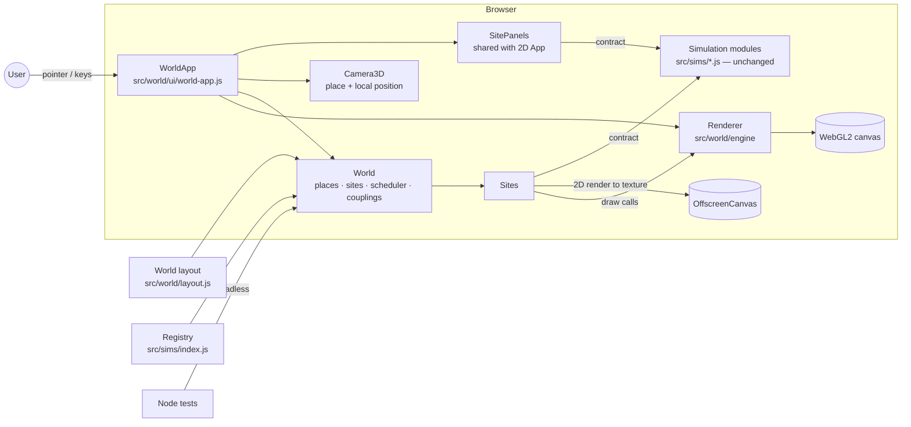
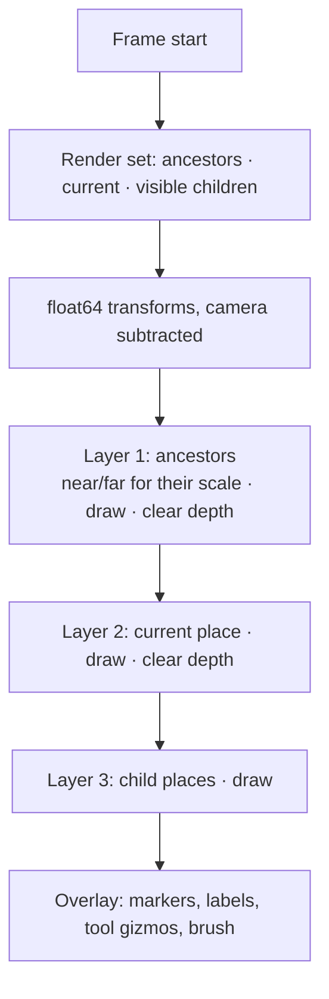
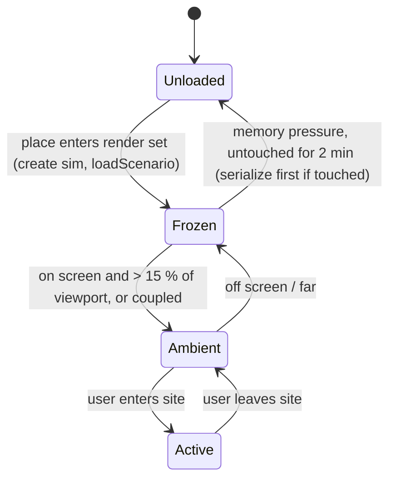

# System Design — Simulations World (3D)

| | |
|---|---|
| **Status** | v1.0: implemented (World Preview, the two P0 native views and five couplings); see [§17](#17-as-built-v1) for where the build differs from this design |
| **Last updated** | 2026-10-19 |
| **Related** | [PRD](PRD.md) · [TRD](TRD.md) · [Plan](PLAN.md) · [ADR-006](../adr/006-in-house-webgl2-renderer.md) · [ADR-007](../adr/007-nested-scale-frames.md) · [ADR-008](../adr/008-sites-wrap-existing-modules.md) · 2D [System Design](../SYSTEM_DESIGN.md) |

---

## 1. Overview

The world is a **new front-end over the existing simulation modules**. It adds a small
WebGL2 engine, a tree of nested places (one per scale), and **sites** that wrap
`Simulation` instances and give them a position, a surface and an activity tier in 3D.
The left and right panels (tools, parameters, inspector, stats, chart) are shared with
the 2D app and always talk to the **active site's** simulation through the unchanged
contract.



### Key properties
- **Modules stay unchanged.** Every module works in the world through a 2D surface
  adapter; native 3D is an optional extra ([ADR-008](../adr/008-sites-wrap-existing-modules.md)).
- **In-house WebGL2, still zero-dependency and no build** ([ADR-006](../adr/006-in-house-webgl2-renderer.md)).
- **Nested places with local frames and a floating origin**, so a galaxy and an atom are
  both precise ([ADR-007](../adr/007-nested-scale-frames.md)).
- **Per-site time.** No global clock; couplings exchange slow quantities, not time steps.
- **Headless-testable.** World, places, scheduler, couplings, picking maths and
  serialisation have no DOM or GL dependency.

## 2. Constraints

| Constraint | Consequence |
|---|---|
| Zero runtime dependencies, no build ([ADR-001](../adr/001-zero-dependency-browser-app.md)) | Own WebGL2 layer of ~2 k lines; shaders as template strings |
| 30 orders of magnitude in one scene | float32 on the GPU cannot hold it; nested frames, CPU float64 transforms, camera-relative rendering |
| Physics must equal the 2D app | Sites call the same modules; the 2D tests are the physics tests |
| Weather costs ~20–25 ms per step | Only one heavy site steps at full rate; a frame budget scheduler |
| Offline PWA | All shaders, meshes and textures generated in code or shipped as small files in `sw.js` cache |
| Must degrade | Atlas + 2D app when WebGL2 is missing or the device is too slow |

## 3. Source layout

New code lives under `src/world/`; nothing in `src/sims/` or `src/core/` moves.

| Path | Responsibility |
|---|---|
| `src/world/engine/math3d.js` | Vectors, bases, mat4 (Float64Array on the CPU), yaw/pitch helpers |
| `src/world/engine/ray.js` | Screen → ray, ray–plane, ray–sphere, ray–AABB, nearest of many spheres |
| `src/world/engine/meshes.js` | Procedural meshes as typed arrays: sphere, quad, box, disc, circles |
| `src/world/engine/materials.js` | GLSL: textured/lit meshes, instanced spheres, points, 1 px lines |
| `src/world/engine/gl.js` | WebGL2 helpers: programs, buffers, attributes, textures, availability check |
| `src/world/engine/renderer.js` | Layers (near/far + depth clear), draw calls, textures, context-loss rebuild |
| `src/world/engine/colors.js` | CSS colour → RGBA |
| `src/world/engine/camera3d.js` | Orbit camera as (place, target, offset); log zoom; hand-over; fly-to across scales |
| `src/world/places.js` | `Place` tree: units, frames (incl. on a globe), extents, conversions, lengths |
| `src/world/layout.js` | The default world and the guided tour (data only) |
| `src/world/site.js` | `Site` base (lazy sim, tiers, history) and `SurfaceSite` (module drawn into a texture) |
| `src/world/native/gravity3d.js` | Native Gravity view: bodies, halos, trails, labels on the orbital plane |
| `src/world/native/globe.js` | Native Global Climate view: band texture on a globe lit at the model's declination |
| `src/world/native/terrain.js` | Native Ecosystem view: terrain raised from the fertility grid, plant-cover texture, instanced animals; rays hit the heightfield |
| `src/world/scheduler.js` | Active and ambient stepping within a budget; catch-up; error isolation |
| `src/world/couplings.js` | Coupling definitions, loop check, smoothing, clamping |
| `src/world/world.js` | `World`: places, sites, tiers, following bodies, couplings, saves |
| `src/world/routes.js` | `#world/...` parse/format/resolve |
| `src/world/ui/world-stage.js` | Controller: main loop, layers, picking, tools, camera input, HUD |
| `src/world/ui/hud.js`, `atlas.js`, `tour.js`, `coupling-panel.js` | Breadcrumb, scale bar, markers, labels; Atlas; tour; Connected science panel |
| `src/ui/tools.js` | The six tools as contract calls, shared by the 2D app and the world |

`index.html` has a `<canvas id="world-gl">` and the HUD in the stage, a **🌍 World** button
in the top bar and *Enter the 3D world* on the welcome screen. The route decides what the
stage shows: `#world…` → the world (loaded on first use), anything else → the 2D view.

## 4. Places and frames

### 4.1 Place model

```ts
interface Place {
  id: string                 // 'solar', 'earth', 'valley' …
  parent: Place | null
  unit: { name: string, metres: number }   // 'AU', 1.496e11
  size: number               // characteristic radius in local units
  frame: {                   // pose of this place inside its parent, in PARENT units
    position: [x, y, z], rotation: quat, scale: number   // parent units per local unit
  }
  enterAt: number            // enter when camera distance < enterAt · size (parent units)
  exitAt: number             // leave to parent when distance > exitAt · size (local units)
  backdrop: 'starfield' | 'sky' | 'lab' | 'none'
  sites: Site[]
  children: Place[]
}
```

Each place has its own unit so local coordinates stay within ~10⁻³…10⁴ — comfortably
inside float32 precision once made camera-relative.

### 4.2 Camera-relative rendering

The camera lives in exactly one **current place** with a float64 position. Each frame:

1. Collect the **render set**: the current place, its ancestors up to a depth of 2
   (backdrops and context), and children whose projected size exceeds a few pixels
   (markers or full LOD).
2. For each place in the set compute `M_place→camera` in **float64** by walking the tree
   (`parent⁻¹ … child` chain), then subtract the camera position *before* converting to
   float32. Objects near the camera therefore have small coordinates.
3. Render **layers back-to-front by scale**: ancestors (far), current place, children
   (near). Each layer gets its own near/far planes and a depth clear, so depth precision
   never spans more than ~5 orders of magnitude.



### 4.3 Hand-over

- **Zoom in:** when the camera's distance to a child place's centre drops below
  `child.enterAt · child.size` (in parent units), the camera's position, target and
  distance are converted into the child's frame and the child becomes current.
- **Zoom out:** when distance exceeds `exitAt · size`, convert into the parent.
- `enterAt` < `exitAt` (after unit conversion) gives hysteresis, so the boundary never
  flickers.
- Zoom speed is proportional to distance (log zoom), so one wheel notch always changes
  scale by the same factor at every level.
- *Fly-to* animates distance in log space and position along a great-circle/ease curve,
  handing over places as it passes thresholds.

### 4.4 Default layout

Defined as data in `src/world/layout.js` (see PRD §6). Example entry:

```js
{ id: 'valley', parent: 'earth', unit: { name: 'km', metres: 1e3 }, size: 20,
  frame: { lat: 34, lon: -10 },            // globe placement helper → position/rotation
  enterAt: 4, exitAt: 60, backdrop: 'sky',
  sites: [
    { id: 'weather',   sim: 'weather',   scenario: 'storm',  surface: { kind: 'slab',  at: [-12, 0, 0], size: [32, 16], depth: 2 } },
    { id: 'ecosystem', sim: 'ecosystem', scenario: 'balanced', surface: { kind: 'ground', at: [6, 0, -6], size: [8, 5] } },
    { id: 'epidemic',  sim: 'epidemic',  scenario: 'town',   surface: { kind: 'ground', at: [6, 0, 6],  size: [6, 4] }, children: ['campus'] },
  ] }
```

Scenario ids above are illustrative; the layout test (TRD W-AR-6) checks every id
against the module's `scenarios`.

## 5. Sites

### 5.1 Site lifecycle and tiers



| Tier | Steps | Renders | Texture/GPU | Notes |
|---|---|---|---|---|
| **Active** (exactly one) | Every frame, `dt · speed` | Every frame | Full resolution | Panels bound to it; tools enabled |
| **Ambient** | Within leftover budget, round-robin | ≤ 10 Hz | Half resolution | Gives the world life; coupled sites tick here too |
| **Frozen** | No | Last frame kept | Last texture | Marker + thumbnail |
| **Unloaded** | No | Marker only | Freed | State kept as a serialised blob if the user touched it |

Simulations are created lazily (`new Sim({ seed })` + `loadScenario`) when their place
first enters the render set, so start-up cost does not grow with the catalogue.

### 5.2 Site interface

```ts
abstract class Site {
  id: string; place: Place; sim: Simulation; tier: Tier
  surface: SurfaceSpec                     // plane | ground | slab | globe | native
  bounds3D(): AABB                         // local place units

  render3D(r: Renderer, frame: FrameCtx): void
  // Map a 3D ray to the module's 2D/3D coordinates; null if missed.
  hit(ray: Ray): { x: number, y: number, z?: number, scale: number } | null
  // Selection gizmo position for an entity (via sim.locate / locate3D).
  locate3D(e): { position: vec3, radius: number } | null
}
```

`scale` is module units per place unit at the hit point; the tools use it to convert
brush radius and drag vectors.

### 5.3 Surface adapter (every module, no code change)

The adapter treats the module exactly like the 2D app does, but draws into an offscreen
canvas that becomes a texture:

1. `OffscreenCanvas` sized to the module's `bounds()` aspect, longest side 1024 px
   (active) or 512 px (ambient), times `devicePixelRatio` capped at 2.
2. A private 2D `View` fitted to `bounds()` with no margin and `yUp` from `meta`.
3. Each render: fill `sim.background`, call `sim.render(ctx, view, ui)`, upload with
   `texSubImage2D` (or `transferToImageBitmap` where faster).
4. The texture is drawn on the surface mesh:

| Surface | Mesh | Used for |
|---|---|---|
| `plane` | Quad facing the camera's default view | Lab bench screens, the atom inset |
| `ground` | Quad on the terrain, slight relief from a height function | Ecosystem, epidemic town |
| `slab` | Vertical quad with a thin box behind it (depth cue) | Weather cross-section |
| `globe` | Texture mapped by latitude on a sphere (equirectangular) | Climate before its native view |
| `native` | Whatever the module's `render3D` draws | Gravity 3D, atoms 3D… |

**Picking:** `ray ∩ surface → (u, v) ∈ [0,1]² → view.toWorld(u·w, v·h)` gives exactly the
module coordinates the 2D app would pass. All six tools then call the contract with
those coordinates. The Force tool projects the drag onto the surface plane; the Energy
brush radius is converted from screen pixels to module units using the hit distance.

Overlays the 2D app draws in screen space (selection ring, brush, force arrow) are drawn
by the world as 3D gizmos instead, at `site.locate3D(selected)`.

### 5.4 Native 3D (optional, per module)

A module may add, without breaking the 2D path:

```ts
static meta.world?: { native: true }       // advertise a 3D view
render3D?(r: Renderer3DApi, frame): void   // draw in its own module units
pick3D?(origin: vec3, dir: vec3, tol: number): Entity | null
locate3D?(e): { x, y, z, r } | null
// Tools: when present, the world passes 3D points; otherwise it projects to (x, y).
add3D?(kind, x, y, z, r?) · move3D?(e, x, y, z) · impulse3D?(e, x, y, z, dx, dy, dz) · energy3D?(x, y, z, r, amount)
```

`Renderer3DApi` is a deliberately small facade (not raw GL): `spheres(instances)`,
`points(instances)`, `lines(polylines, width)`, `mesh(meshId, transform, material)`,
`texturedSphere(texture, latLon)`, `volumeSlab(field, w, h, d)`, `label(text, pos)`.
Modules never touch WebGL directly, so the engine can move to WebGPU later.

| Module | Native view | Physics change needed |
|---|---|---|
| Gravity | 3D bodies, trails, orbit ellipses with inclination | Optional `z, vz`; Barnes–Hut octree; existing planar scenarios unchanged (z = 0) |
| Global Climate | Globe: bands → latitude texture, ice caps, terminator, season tilt | None (render only) |
| Weather | Slab extruded in depth; cloud/rain particles; sky tint by time of day | None (render only) |
| Ecosystem | Terrain from fertility; grass colour; animals as instanced meshes | None (render only) |
| Atoms & Molecules | 3D box, ball-and-stick | Optional 3D MD mode (z, 3D spatial hash) behind a parameter |
| Cell | Sphere membrane, particles in 3D | Later; render-only first |
| Atomic Structure | Shells as spheres, orbital clouds | None (render only) |

Physics changes to 3D are separate, tested module work (new SM requirements) and never
change the default 2D behaviour.

## 6. Tools in 3D

| Tool | pointerdown | pointermove | pointerup / per frame |
|---|---|---|---|
| Inspect | `site.hit(ray)` → `sim.pick` → select | Orbit camera if dragged > 4 px | — |
| Move | pick target | `hit(ray)` on the surface (or a camera-facing plane through the entity for native 3D) → `move` | release |
| Add | `hit` → `add(kind, x, y, r)` | — | — |
| Remove | `hit` → `removeAt` | repeat every 60 ms | — |
| Force | remember target and hit | draw 3D arrow on the surface plane | `impulse` with projected drag |
| Energy | — | track `hit` | each frame `energy(x, y, r·scale, ±s·dt)` |
| Right/middle drag, wheel, pinch | | orbit / pan / zoom | |

Clicks that miss the active site but hit another site's marker or surface fly there
and make it active. Clicks on empty space only move the camera.

## 7. Main loop and scheduler

```mermaid
sequenceDiagram
  participant RAF as requestAnimationFrame
  participant App as WorldApp
  participant Sch as Scheduler
  participant S as Sites
  participant C as Couplings
  participant R as Renderer
  RAF->>App: frame(now)
  App->>App: dt = min(50 ms, now − last); camera update; hand-over
  App->>Sch: plan(budget = 10 ms)
  Sch->>S: active.sim.step(dt · speed)
  Sch->>S: ambient sites, round-robin, while budget remains
  opt every 1 s (world tick)
    C->>S: read outputs (stats / outputs()) → transform → setParam on targets
  end
  App->>R: begin frame
  App->>S: render3D (active + visible ambient/frozen)
  App->>R: overlays (markers, labels, gizmos), end frame
  opt every 250 ms
    App->>App: stats panel, chart sample (shared SitePanels)
  end
```

- **Budget:** default 10 ms of simulation per frame (measured with `performance.now()`),
  adapted down if frame time exceeds 20 ms for 1 s. The active site always steps first;
  if it alone exceeds the budget (Weather), ambient sites skip that frame.
- **Ambient step size:** an ambient site that was skipped accumulates `dt` and catches up
  with one capped step (≤ 4 × frame dt), so it keeps roughly its pace without spikes.
- **Errors:** a throwing `step` freezes that site, shows a badge, logs once (as in 2D).
- **Web Workers (later):** heavy modules move to a worker with transferable typed arrays;
  the scheduler then budgets only the main-thread share. The site API does not change.

## 8. Couplings

Couplings join sites through the **existing contract only**: they read a source's
`stats()` (or an optional `outputs()` for values not shown as stats) and write a
target's **parameters** with `setParam`. Modules stay unaware of each other (2D TRD AR-5).

```ts
interface Coupling {
  id: string; label: string; explain: string
  from: SiteId; to: SiteId
  read(src: Simulation): number            // e.g. climate T at the Valley's latitude
  write(dst: Simulation, v: number): void  // e.g. dst.setParam('temperature', map(v))
  unit: string; smoothing: number          // exponential smoothing time in world ticks
}
```

Built in v1 (all off by default): **Earth's orbit → Climate** (Earth–Sun distance → `solar`),
**Climate → Weather** (sunlight at the valley's latitude → `sun`), **Climate → Ecosystem**
(temperature → `temperature`), **Weather → Ecosystem** (rain in the last 10 s → `growth`) and
**Climate → Epidemic** (winter → higher `beta`). The table below is the original plan.

| Coupling | Reads | Writes | New module surface needed |
|---|---|---|---|
| Stars → Climate | Sun-like star's luminosity (`describe` field `L`) | `climate.solar` (× 1361 W/m²) | `outputs()` on Stars for a tagged "Sun" star |
| Gravity → Climate | Earth's distance from the Sun | `climate.solar` (inverse square) | `outputs()` on Gravity for a named body |
| Climate → Weather | Band temperature at Valley latitude, season | Weather surface heating (`sun`) and an offset | `outputs({ lat })` on Climate; a `surfaceOffset` param on Weather |
| Weather → Ecosystem | Accumulated precipitation (`precip`) | `ecosystem.growth` | None |
| Climate → Ecosystem | Seasonal temperature at Valley latitude | `ecosystem.temperature` | `outputs({ lat })` on Climate |
| Climate → Epidemic | Season | `epidemic.beta` (seasonal multiplier) | None |

Rules:
- **Quantities, not time.** Each site keeps its own clock and speed. A coupling ticks once
  per world second and passes smoothed values, which is physically honest for slow
  drivers (insolation, climate) and is labelled as such where it is not.
- **Off by default.** With no couplings a site matches its 2D module exactly.
- **Visible.** A coupled parameter shows a link badge and its source in the parameter
  panel; the user's slider is disabled while the coupling drives it (unlock = turn off).
- **Acyclic.** The coupling graph is checked to be a DAG; cycles are refused.
- Coupled sources are kept at least *Ambient* so they keep producing values.

## 9. Data model, persistence and routes

### 9.1 World save

```json
{ "format": "simulations-world3d", "version": 1,
  "camera": { "place": "valley", "target": [0, 0, 0], "distance": 30, "yaw": 0.6, "pitch": 0.4 },
  "active": "weather",
  "couplings": ["weather->ecosystem"],
  "sites": { "weather": { …simulation.serialize()… }, "gravity-solar": { … } } }
```

- Only **touched** sites (any tool, parameter or scenario change) are stored; untouched
  ones are recreated from layout + seed, so a save of a short visit is small.
- Each site blob is the unchanged 2D save format, so `deserialize` and its validation
  ([SP-4](../TRD.md#9-security-and-privacy)) are reused. A 2D save file dropped onto the world
  opens the matching site.
- Undo/redo uses one `History` per site, as in 2D; switching site switches history.

### 9.2 Routes

```
#world                                   → default camera at Deep Space
#world/solar                             → place
#world/earth/valley/weather              → site (path of place ids + site id)
#world/earth/valley/weather?stability=8&lock=all&view=d30,y0.6,p0.4
```

Parameters after `?` follow the 2D share-link rules (only values that differ from the
scenario, typed and clamped). `view` encodes distance/yaw/pitch compactly.

## 10. Rendering details

| Topic | Choice |
|---|---|
| API | WebGL2 (instancing, VAOs, float textures, MRT). WebGPU path later behind `Renderer3DApi` |
| Colour | Linear workflow, sRGB output, simple tone map; dark theme matches the 2D app |
| Lighting | One directional light (the Sun's direction from the current place) + ambient; unlit for fields and textures |
| Instancing | Spheres/points drawn with one instanced call per material (planets, stars, atoms, animals, people) |
| Lines | Screen-space-width lines via instanced quads (trails, bonds, orbits, gizmos) |
| Labels | Canvas-2D text atlas; markers as billboards with occlusion fade |
| Backdrops | Procedural starfield (seeded), gradient sky with sun position, simple lab room |
| Anti-aliasing | MSAA 4× when available; FXAA off by default |
| Quality presets | Low / Medium / High: resolution scale, MSAA, ambient site rate, texture size |
| Context loss | Rebuild GPU resources from CPU-side descriptions; simulations are unaffected |
| HiDPI | `devicePixelRatio` capped at 2 (1.5 on Low) |

## 11. Performance design

| Budget (reference laptop) | Target |
|---|---|
| Frame | 16.7 ms while flying, ≤ 33 ms with Weather active |
| Simulation share | ≤ 10 ms (adaptive) |
| Render (CPU) | ≤ 3 ms: < 300 draw calls via instancing; culling per place and site |
| Texture uploads | ≤ 1 active (1024²) per frame + ambient at ≤ 10 Hz (512²) |
| GPU memory | ≤ 256 MB on Medium |
| Start-up | First frame ≤ 3 s: Deep Space only; other places and modules load lazily via dynamic `import()` |

Techniques: lazy site creation; tiered stepping; texture reuse; instancing; frustum and
size culling per place; float64 on the CPU only for frames (not per entity); typed
arrays for instance buffers updated in place.

## 12. Error handling and fallbacks

| Situation | Behaviour |
|---|---|
| No WebGL2 / context creation fails | Show the Atlas as a list; each entry opens the 2D app |
| Sustained < 20 fps for 5 s | Offer to lower quality; then to switch to 2D |
| Context lost | Pause, restore resources, resume |
| Site `step`/`render` throws | Freeze site, badge it, keep the world running |
| Invalid world file or route | Same validation as 2D; unknown sites/places ignored with a notice |

## 13. Security and privacy

Unchanged from the 2D app: no network calls at runtime, no `eval`, DOM built with
`textContent`, world files treated as untrusted and validated per site. Shaders are
static strings in the source, never built from user data.

## 14. Testing strategy

| Level | What | Where |
|---|---|---|
| Unit (Node) | math3d, ray intersections, place transforms and hand-over hysteresis, routes, scheduler budgeting, coupling graph and transforms, world serialise round-trip | `tests/world-*.test.js` |
| Contract | Every registered module loads as a surface site; every tool through `hit()` produces the same calls as the 2D app for the same point | `tests/world-contract.test.js` |
| Layout | Every layout site references a registered module and valid scenario; every module appears at least once | `tests/world-layout.test.js` |
| Physics | Existing SM tests unchanged; new tests for any 3D physics mode | existing + new |
| E2E (Playwright, SwiftShader) | Load `#world`, fly to each site, use each tool, save/load, share link, fallback without WebGL2 | `tests/e2e/world.e2e.mjs` |
| Visual | Screenshot per place compared with a tolerance | `scripts/screenshots.mjs` extension |
| Perf | Frame-time probe over a scripted tour; budget assertions in CI as warnings | `tests/e2e/world-perf.e2e.mjs` |

## 15. Deployment

No change: static files, GitHub Pages workflow, PWA. Add `src/world/**` to the service
worker's cache list and bump `CACHE`. The world adds no build step.

## 16. Evolution

| Extension | Mechanism |
|---|---|
| New module | Registry entry + one layout entry (surface adapter); `render3D` later |
| New place | Layout data only |
| Faster physics | Workers per heavy site; WebGPU compute for grids/particles |
| WebGPU rendering | Second backend behind `Renderer3DApi` |
| Headsets | WebXR session on the same renderer (two views per frame) |
| Deeper coupling | Field couplings (e.g. climate map → weather boundary profile) using `outputs()` with arrays |

## 17. As built (v1)

Where the implementation differs from the design above, and why:

| Design | As built | Reason |
|---|---|---|
| `SitePanels` extracted from `app.js`; a separate `WorldApp` | The panels stay in `App`; `App.bindSim(sim, { history, driven })` binds the active site, and the world is a *stage* of the same app (`WorldStage`) | Review R1: smaller change, the 2D app is untouched in behaviour |
| Camera as (place, target, distance, yaw, pitch) | (place, target, offset) with an eased up vector | Review R4: exact hand-over into rotated frames (the valley on the globe) |
| Fly-to in the common ancestor's units | Each moment of a flight works in the deepest place whose extent contains the camera distance | Precision at both ends of a galaxy-to-atom flight |
| Ray–instanced-sphere picking in 3D | Native Gravity picks on its orbital plane with the module's own `pick` | In the 3D physics mode a body is picked where it projects onto the plane |
| Labels from a canvas text atlas; billboards | DOM buttons (markers) and spans (planet names) over the canvas | Review R7: accessible and simpler |
| Lines with a width | 1 px lines | Review R10: WebGL2 ignores widths above 1 |
| Stars → Climate first | Earth's orbit → Climate, Climate → Weather/Ecosystem/Epidemic, Weather → Ecosystem | Stars has no "Sun" star yet (review R9); Stars → Climate stays on the plan |
| — | Zooming over a moving place's marker locks the camera onto it | The Earth moves 2π AU per two seconds in the Solar System scenario |
| — | Ancestor places' sites are frozen while you are inside a child | The orbiting Earth would otherwise swing the Sun round the sky |
| — | A site may set parameters for its setting (`params` in the layout) | The galaxy collision runs slower in the world so it can be watched |
